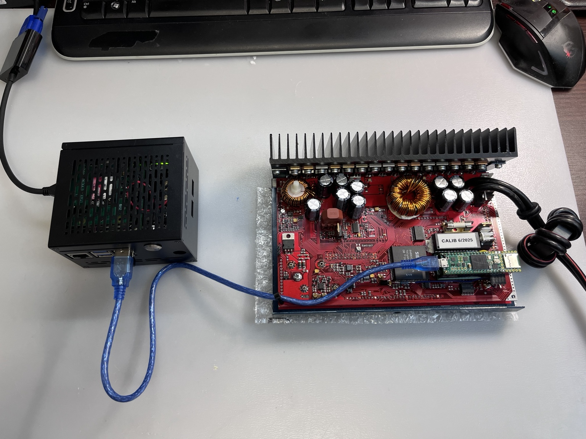
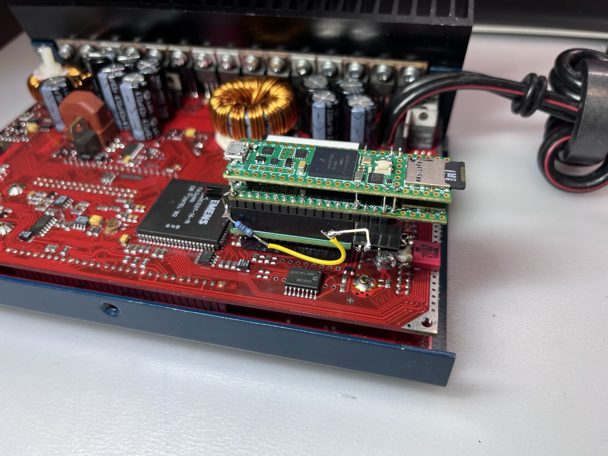
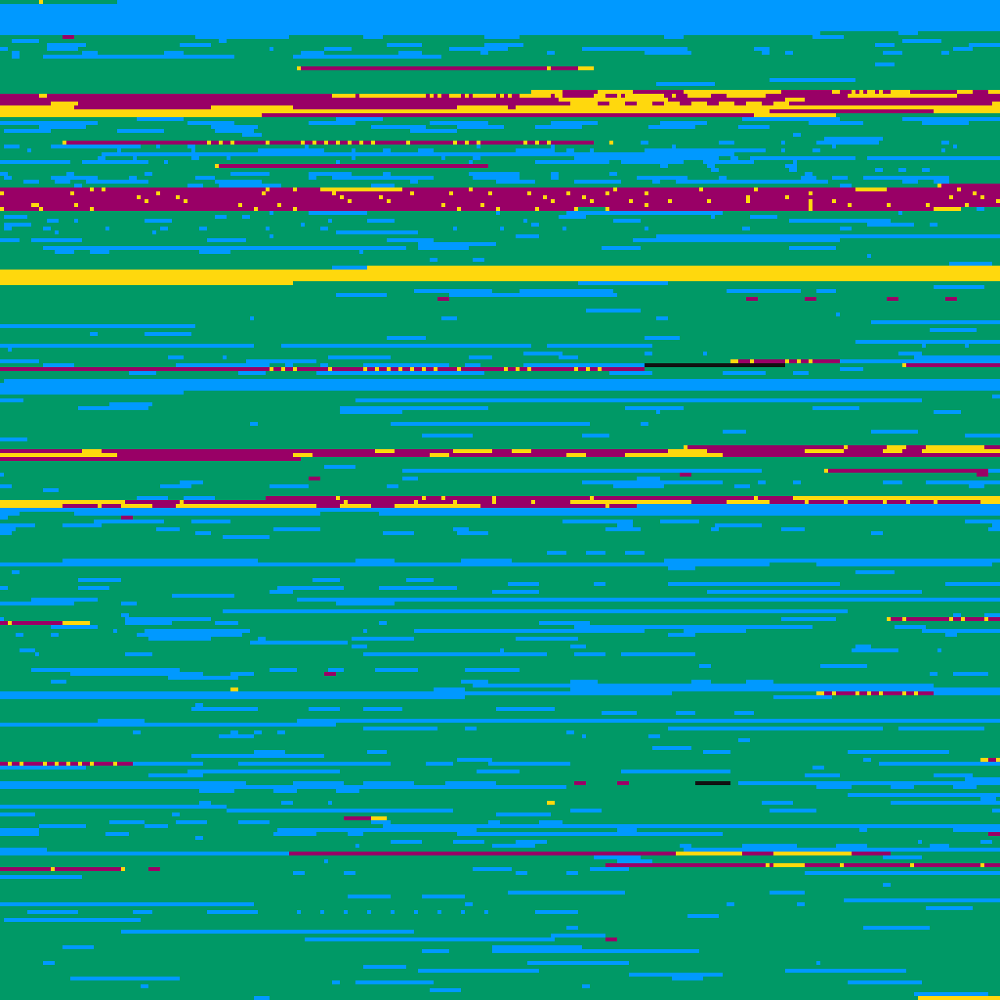

# ISL8-936G Firmware Reconstruction

**Hardware-assisted firmware analysis and CODE/DATA recovery for the Siemens 80C537 (8051 family)**

**Martin Stránský (Prometheuss80)** · 2026 · Original tools: MIT License

An independent reverse-engineering and preservation project for the **Schulze ISL8-936G** battery charger. The project combines a **Teensy 4.1 ROM emulator**, a **Raspberry Pi 5 address-bus logger**, time-ordered execution traces, and a series of numbered Python tools to reconstruct an assembler source file for **Keil A51 / µVision**.

> **The central challenge is CODE versus DATA.** A raw 64 KiB ROM image does not say which bytes are executable 8051 instructions and which are lookup tables, text, constants, or other data. Disassembling everything as code creates false instructions, references, and labels. Our approach uses real **TIME TRACE** recordings of CPU ROM-address activity to help identify **executed CODE regions** and distinguish them from **DATA regions**, supplemented by manually confirmed CODE/DATA address lists. Trace observations are powerful evidence, but addresses not observed during a capture are not automatically data.

[Česky / Czech README](README_CS.md) · [Workflow](docs/WORKFLOW.md) · [Scripts](docs/SCRIPTS.md) · [Hardware acquisition](docs/ACQUISITION.md) · [Image gallery](docs/PHOTOS.md)

## Project at a glance

| Item | Result / configuration |
| --- | --- |
| Target | Schulze ISL8-936G, Siemens 80C537 (8051 family) |
| ROM image | 64 KiB (address space `0000h–FFFFh`) |
| ROM interface | Teensy 4.1 emulator with 3.3 V / 5 V interface adapter |
| Trace logger | Raspberry Pi 5 (8 GB), USB-connected to emulator; battery-backed logger case |
| CPU clock during acquisition | Reduced from **16 MHz to 1 MHz** |
| Hardware change during acquisition | External **MAX706 watchdog temporarily removed** to prevent resets at reduced clock |
| Captured trace volume | Approximately **26 GB** (project acquisition report) |
| Reported CODE coverage | **Over 83%** of identified executable firmware code captured (project estimate; not a count of all possible runtime paths) |
| Output | `Reconstruction.a51`, intended for Keil A51 / µVision |

## Hardware-based acquisition



*ISL8-936G acquisition setup: the ROM emulator is installed in the charger and communicates with a Raspberry Pi 5 logger in a case with a backup battery supply.*

The ROM emulator replaces the ROM interface in the charger, monitors the addresses accessed by the original CPU, and streams address events to the Raspberry Pi 5. To allow sufficient time for capturing the bus accesses, the CPU clock was slowed from its original **16 MHz to 1 MHz**. At this rate the **MAX706 external watchdog caused resets**, so it was removed temporarily for acquisition. These are **laboratory modifications**, not instructions for normal charger operation.



*Close-up: Teensy 4.1 ROM emulator mounted on the 3.3 V / 5 V interface adapter inside the charger.*

The acquisition covered the charger functions exercised during the experiments and produced approximately **26 GB of address traces**. The project's reported coverage exceeded **83% of identified executable code**. This figure is a project-reported reconstruction metric, **not** proof that 83% of every conceivable execution path was tested. See [Acquisition notes](docs/ACQUISITION.md).

## CODE/DATA coverage visualization



*Example coverage visualization from `110_SERVER_FINAL.py`: classifications combine time-trace CODE/DATA addresses with user-confirmed CODE/DATA lists. This picture belongs to the actual research dataset, **not** to the six-address synthetic demo.*

The map makes the principal task of the reconstruction visible: separating areas established as **CODE** from areas classified as **DATA**, while keeping unknown regions distinguishable. The mapping script applies confirmed user classifications before time-trace classifications; unresolved addresses remain unclassified.

## From bus trace to assembler

```text
ISL8 CPU 80C537 → ROM address bus → Teensy 4.1 ROM emulator
                                    ↓ USB
                              Raspberry Pi 5
                                    ↓
                           LOG_ISL8_ALL.txt
                                    +
                       locally supplied ROM BIN
                                    ↓
                numbered Python reconstruction scripts
                                    ↓
                   TIME TRACE + CODE/DATA analysis
                                    ↓
                        Reconstruction.a51
                                    ↓
                      Keil A51 / µVision
```

A typical logger event looks like `0000*0@`: four hexadecimal address digits, `*`, an event sequence number and `@` terminator. **The trace records the accessed address; the byte value comes from the corresponding address of the local ROM image.** The script series validates and processes the trace, constructs temporal/address maps, distinguishes CODE from DATA, emits assembly, generates labels, and runs consistency checks. See [WORKFLOW](docs/WORKFLOW.md) and [SCRIPTS](docs/SCRIPTS.md).

## Public six-address demonstration

To let others test the toolchain **without distributing any proprietary Schulze ROM**, this release includes an **entirely synthetic** 65,536-byte file named `fw850en.bin` (name retained for script compatibility). All bytes are `00h` (`NOP`) except two jumps:

| ROM address | Machine bytes | Instruction |
| --- | --- | --- |
| `0000h–0002h` | `02 FE 80` | `LJMP 0FE80h` |
| `FE80h–FE82h` | `02 00 00` | `LJMP 0000h` |

`LOG_ISL8_ALL.txt` contains exactly:

```text
0000*0@
0001*1@
0002*2@
FE80*3@
FE81*4@
FE82*5@
```

**This demo BIN is not working charger firmware. Never flash it to an ISL8.** The six-address demonstration illustrates the reconstruction mechanism, not the coverage or fidelity of the full research capture.

### Quick start (offline demonstration)

Run from the repository root using Python 3:

```bash
python 002_TEST.py
python 005_RESULT.py
python 006_DATA.py
python 007_OUTPUT.py
python 050_BLOCK_1B_PC.py
python 051_TIME_TRACE.py
python 052_TRACE.py
python 101_RECONSTRUCTION_FINAL.py
python 102_FILL_FINAL.py
python 103_RENAME_FINAL.py
python 104_LABEL.py
python 105_JUMPS.py
python 106_STRIPPED.py
python 107_CHECK_FINAL.py
python 108_PROCESS_FINAL.py
```

A sample `examples/Reconstruction.a51` is included. The demo processing steps were exercised and generated source; **Keil assembly and a complete binary round-trip comparison were not independently verified** in this release. For full recordings, `001_...` capture tools and optional `003_SPLIT.py`/`004_JOIN.py` can be used. See [Demo details](docs/DEMO.md).

## Source preservation and known small corrections

All numbered tools keep their canonical names and execution order. Three public-release fixes were retained from the preceding package: `003_SPLIT.py` uses three-digit segment numbers compatible with `004_JOIN.py`, and `005_RESULT.py` / `006_DATA.py` accept multi-digit event indices. Original versions are preserved in `docs/original_scripts/`. Other tool source files are kept unchanged from the prior release; this photo/documentation update does not modify reconstruction algorithms.

## Requirements and responsible use

The offline demo uses **Python 3**. Hardware acquisition additionally uses a **Teensy 4.1**, a **Raspberry Pi 5**, a suitable interface adapter and the logger software; logging tools may require `pyserial`. Keil A51 / µVision is required to assemble generated source.

Original firmware images, actual trace archives, and vendor-owned software are **not distributed**. This is an independent research and preservation project, not affiliated with Schulze Elektronik. Use only ROM images you are authorized to analyze. The hardware changes described above were performed as part of the research and should not be carried out on a charger intended for regular battery charging without appropriate expertise and safety precautions.

Copyright © 2026 **Martin Stránský (Prometheuss80)**. The MIT license covers original project code and documentation only; third-party components retain their own terms.
