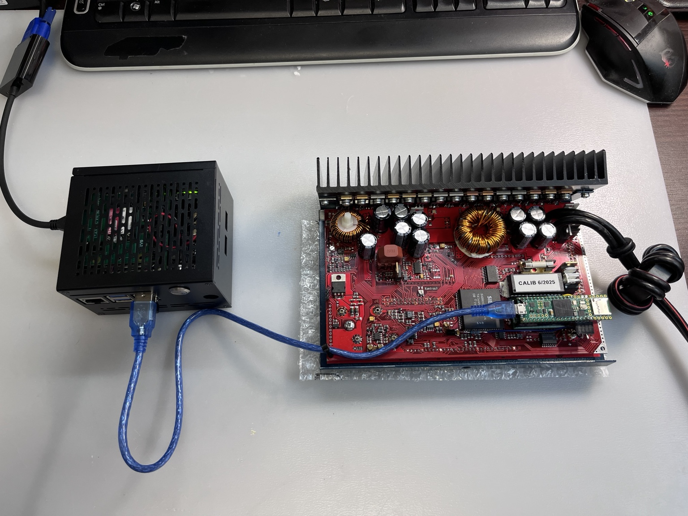
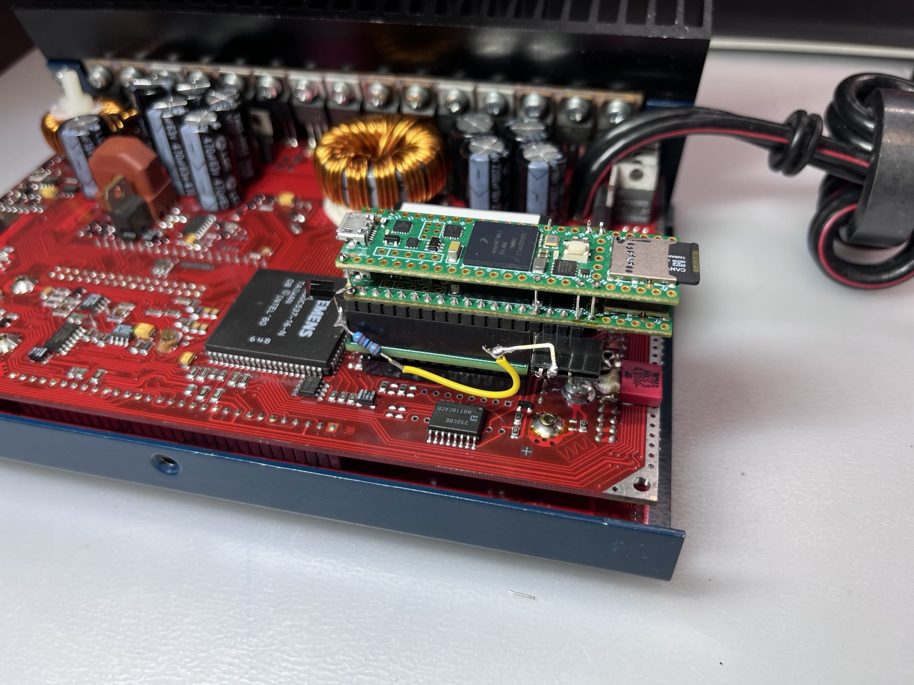
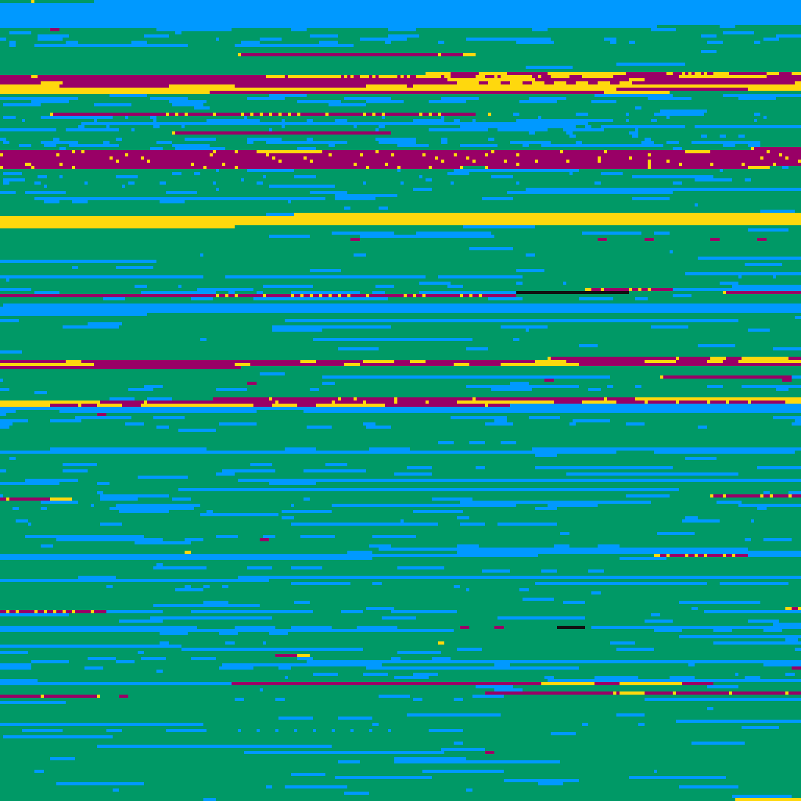

# Rekonstrukce firmware ISL8-936G

**Rekonstrukce firmware s využitím skutečného TIME TRACE a rozlišení CODE/DATA — Siemens 80C537 (8051)**

**Martin Stránský (Prometheuss80)** · 2026 · Vlastní nástroje: licence MIT

Nezávislý projekt analýzy a zachování firmware nabíječe **Schulze ISL8-936G**. Propojuje **ROM emulátor Teensy 4.1**, **datalogger Raspberry Pi 5**, časové záznamy adresových přístupů CPU a posloupnost očíslovaných Python skriptů. Výsledkem je `Reconstruction.a51` určený pro **Keil A51 / µVision**.

> **Hlavní problém rekonstrukce: oddělení CODE a DATA.** Samotný 64kB binární obraz ROM neobsahuje informaci, které bajty jsou instrukcemi procesoru 8051 a které představují tabulky, texty, konstanty či jiná data. Při chybném výkladu dat jako instrukcí vznikají falešné skoky a návěští. Náš systém využívá skutečný **TIME TRACE průběhu adres na sběrnici CPU** k identifikaci **vykonávaných oblastí CODE** a k rozlišení oblastí **DATA**. Pozorování doplňují adresy CODE/DATA potvrzené uživatelem. To, že některá adresa během měření nebyla zaznamenána, však samo o sobě nedokazuje, že obsahuje DATA.

[English README](README.md) · [Postup rekonstrukce](docs/WORKFLOW.md) · [Seznam skriptů](docs/SCRIPTS.md) · [Podmínky měření](docs/ACQUISITION.md) · [Fotogalerie](docs/PHOTOS.md)

## Projekt v číslech

| Parametr | Hodnota |
| --- | --- |
| Nabíječ | Schulze ISL8-936G, CPU Siemens 80C537 |
| Rozsah ROM | 64 KiB (`0000h–FFFFh`) |
| Emulátor ROM | Teensy 4.1, redukce logických úrovní 3,3 V / 5 V |
| Datalogger | Raspberry Pi 5 (8 GB), pouzdro se záložním bateriovým zdrojem |
| Frekvence CPU při záznamu | **Snížena z 16 MHz na 1 MHz** |
| Úprava pro měření | Dočasné odstranění externího watchdogu **MAX706** |
| Zaznamenaná data | Přibližně **26 GB** |
| Pokrytí | Podle výsledků projektu **více než 83 % identifikovaného vykonatelného kódu**; nejde o procento všech možných cest programu |
| Výstup | `Reconstruction.a51` pro Keil A51 / µVision |

## Skutečná měřicí sestava



*Propojení nabíječe ISL8-936G s dataloggerem Raspberry Pi 5. Raspberry Pi je v pouzdře se záložním bateriovým zdrojem; ROM emulátor je vložený přímo do nabíječe.*

Teensy 4.1 na rozhraní ROM sleduje adresy, které CPU načítá, a předává události přes USB do Raspberry Pi 5. Aby šlo tuto komunikaci spolehlivě zaznamenávat, musela být **frekvence CPU snížena z 16 MHz na 1 MHz**. Při sníženém taktu externí watchdog **MAX706** opakovaně resetoval procesor, proto byl během měření **dočasně odstraněn**. Jde o úpravy provedené v laboratorních podmínkách, nikoliv o postup pro běžný provoz nabíječe.



*Detail ROM emulátoru Teensy 4.1 s adaptérem logických úrovní na základní desce nabíječe.*

Při postupném zachycování funkcí nabíječe vzniklo **přibližně 26 GB záznamů**. Projekt dosáhl uváděného **pokrytí přes 83 % identifikovaného vykonatelného kódu**. Tato hodnota není důkazem pokrytí 83 % všech možných běhových cest; jde o údaj z analýzy rekonstrukce.

## Mapa pokrytí CODE/DATA



*Ukázka mapy pokrytí ze skutečného výzkumného záznamu, generovaná postupem `110_SERVER_FINAL.py`. Není to mapa syntetického šestibajtového testu.*

Mapa rozlišuje klasifikace **TIME CODE**, **TIME DATA**, **USER CODE**, **USER DATA** a dosud neurčené oblasti. Uživatelsky potvrzené oblasti mají ve skriptu vyšší prioritu než klasifikace z časového záznamu. Právě toto rozdělení je klíčové: umožňuje rekonstruovat assembler bez zaměňování datových tabulek za strojové instrukce.

## Princip rekonstrukce

```text
Schulze ISL8 / CPU 80C537 → adresová sběrnice ROM → Teensy 4.1
                                                 ↓ USB
                                          Raspberry Pi 5
                                                 ↓
                                         LOG_ISL8_ALL.txt
                                                 +
                                          lokální BIN ROM
                                                 ↓
                                    očíslované Python skripty
                                                 ↓
                                   TIME TRACE, CODE / DATA
                                                 ↓
                                         Reconstruction.a51
                                                 ↓
                                          Keil A51 / µVision
```

Logger zapisuje například `0000*0@`: čtyřmístná HEX adresa, oddělovač `*`, pořadové číslo události a ukončovací znak `@`. **LOG obsahuje adresy; skutečné bajty instrukcí se načítají ze vstupního BIN na příslušných adresách.** Skripty postupně kontrolují záznamy, vytvářejí mapy, vyhodnocují CODE/DATA, rekonstruují assembler, tvoří návěští a kontrolují kolize. Podrobnosti: [WORKFLOW](docs/WORKFLOW.md), [SCRIPTS](docs/SCRIPTS.md).

## Veřejná demonstrace bez originálního firmware

Pro nezávislé vyzkoušení obsahuje balíček **syntetický** `fw850en.bin` o délce přesně 65 536 bajtů (název odpovídá požadavkům existujících skriptů). Všechny bajty jsou `00h` (`NOP`), kromě dvou instrukcí:

| Adresy | Bajty | Instrukce |
| --- | --- | --- |
| `0000h–0002h` | `02 FE 80` | `LJMP 0FE80h` |
| `FE80h–FE82h` | `02 00 00` | `LJMP 0000h` |

`LOG_ISL8_ALL.txt` obsahuje jen šest adres:

```text
0000*0@
0001*1@
0002*2@
FE80*3@
FE81*4@
FE82*5@
```

**Tento BIN není skutečný firmware nabíječe a nesmí být nahráván do nabíječe.** Demonstruje mechanismus našich skriptů, nikoliv rozsah či kvalitu původního 26GB záznamu.

### Rychlý test (bez měřicího hardware)

V kořenové složce projektu spusť s Pythonem 3:

```bash
python 002_TEST.py
python 005_RESULT.py
python 006_DATA.py
python 007_OUTPUT.py
python 050_BLOCK_1B_PC.py
python 051_TIME_TRACE.py
python 052_TRACE.py
python 101_RECONSTRUCTION_FINAL.py
python 102_FILL_FINAL.py
python 103_RENAME_FINAL.py
python 104_LABEL.py
python 105_JUMPS.py
python 106_STRIPPED.py
python 107_CHECK_FINAL.py
python 108_PROCESS_FINAL.py
```

Ukázkový `examples/Reconstruction.a51` je přiložen. Hlavní řetězec byl na demonstračních datech vyzkoušen; **sestavení v Keilu a úplné porovnání výsledného BIN zatím nebylo nezávisle ověřeno**. Pro dlouhé záznamy slouží nástroje loggeru `001_...` a volitelné `003_SPLIT.py` / `004_JOIN.py`. Viz [docs/DEMO.md](docs/DEMO.md).

## Původní skripty a opravy

Zachováváme původní názvy i číslování skriptů. Ve veřejném balíčku zůstaly dříve provedené drobné opravy: `003_SPLIT.py` generuje tříciferné číslování dílů kompatibilní s `004_JOIN.py` a `005_RESULT.py` / `006_DATA.py` přijímají vícemístná pořadová čísla událostí. Původní verze těchto tří skriptů jsou v `docs/original_scripts/`. Tato aktualizace fotografií a dokumentace nijak nemění algoritmy rekonstrukce.

## Požadavky a práva

Pro demonstrační test stačí **Python 3**. Skutečný záznam vyžaduje **Teensy 4.1**, **Raspberry Pi 5**, odpovídající redukci a datalogger, případně Python balíček `pyserial`. Pro sestavení výsledného assembleru je potřeba Keil A51 / µVision.

Originální proprietární firmware ani skutečné datové archivy výrobce se nezveřejňují. Projekt je nezávislý na Schulze Elektronik. Pracuj pouze s firmware, k jehož analýze máš oprávnění. Popsané zásahy do hardware patří do servisního a výzkumného prostředí.

Copyright © 2026 **Martin Stránský (Prometheuss80)**. Licence MIT platí pouze pro původní vlastní software a dokumentaci; práva třetích stran zůstávají nedotčena.
