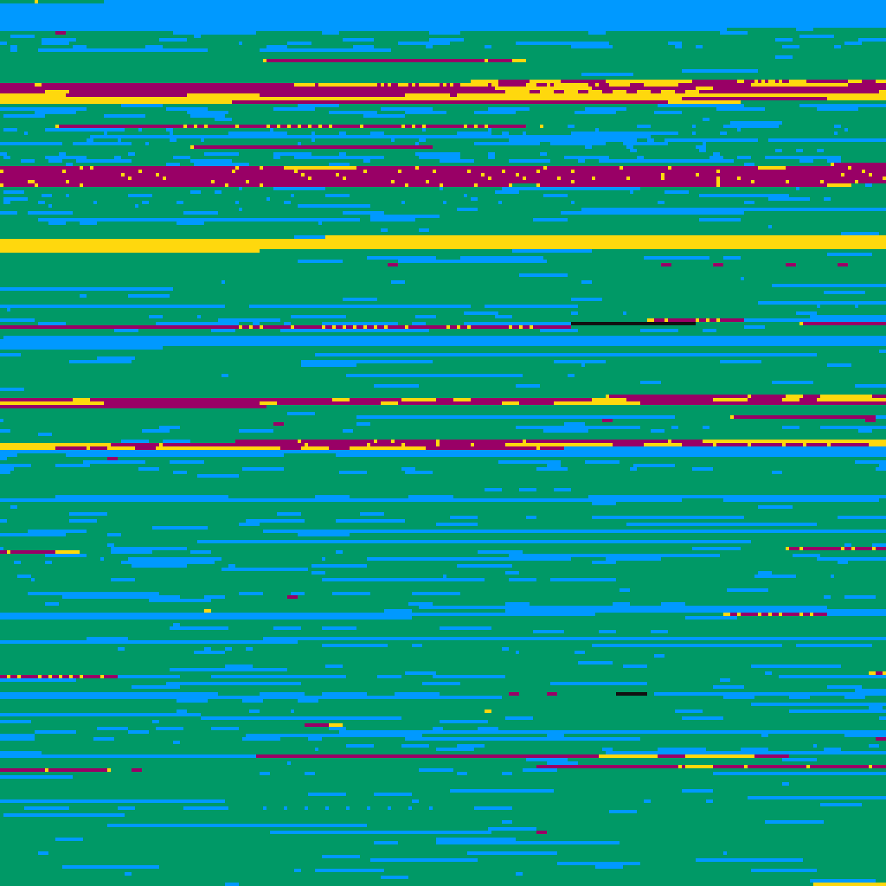

# Hardware acquisition and CODE/DATA classification

## What was measured

The original Siemens 80C537 CPU ran in the ISL8-936G while a **Teensy 4.1 ROM emulator** observed accesses to its ROM address bus. The emulator forwarded time-ordered address events to a **Raspberry Pi 5 (8 GB)** running the logger, via USB. The Pi was housed in a case with a backup battery supply. These traces represent observed bus access events, **not** a copy of the ROM contents.

## Practical constraints of acquisition

- The research setup required slowing the CPU clock from **16 MHz to 1 MHz** for reliable acquisition with this equipment.
- The external **MAX706 watchdog** triggered resets at the reduced clock frequency. It was therefore **temporarily removed for data acquisition**. This is a research-only modification and must not be considered an acceptable operating state for normal charging.
- Approximately **26 GB** of logging data were collected while exercising the charger's available functions and states.
- The project reports **over 83% executable-code coverage**. This is a project-derived estimate of identified executable ROM code observed in the capture, **not** coverage of all possible execution paths, nor a figure reproducible from the six-address demo.

## Why TIME TRACE matters

An 8051 binary mixes instructions with inline constants, lookup tables, text and other data. A purely linear disassembly can mistake data for instructions and give a misleading control-flow graph. The primary research goal was to classify ROM addresses as **CODE** or **DATA** using real CPU behavior. The scripts analyze observed address sequences and produce `TIME_CODE_ADDRS.txt` and `TIME_DATA_ADDRS.txt`, complemented by user-confirmed `FINAL_USER_CODE.txt` and `FINAL_USER_DATA.txt`. These records guide assembly reconstruction and help prevent CODE/DATA collisions.

Important limits: unvisited regions remain unknown; observed address traffic must be interpreted with knowledge of the bus and processing method. The method is a powerful classification aid, not a mathematical proof for every ROM byte.

## Visualization

`110_SERVER_FINAL.py` builds classification data for the visualization from the locally available ROM image and address lists. The script's priority is **USER CODE**, **USER DATA**, **TIME CODE**, **TIME DATA**, and finally **unknown**. The included `coverage_map.png` is an example from the actual research dataset, provided only as an illustration; the source capture is not redistributed.

## Source and attribution

Technical acquisition details and quantitative metrics in this document are reported by the original project author and documented alongside the accompanying code and photographs. Reconstructing or quantitatively independently verifying the 26 GB capture and >83% metric is not possible with the intentionally tiny public demo.
