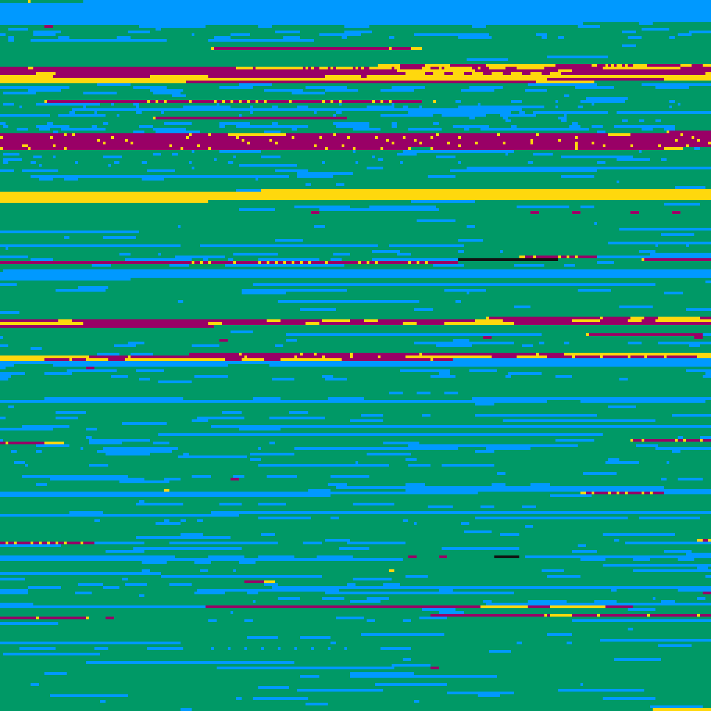
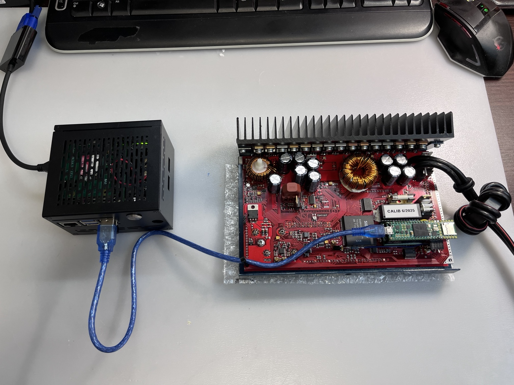
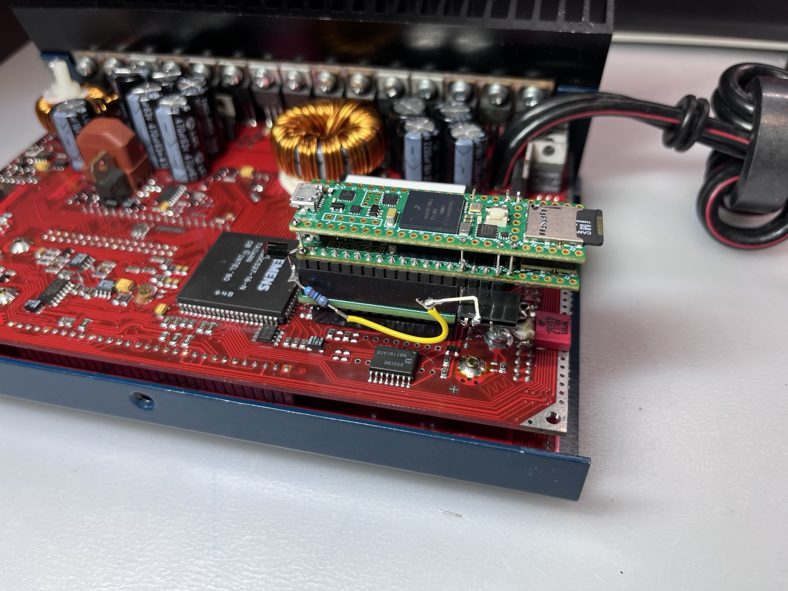

# Hardware and coverage image gallery

These are original photographs/visualizations supplied by the project author. Images document the **actual research setup**; they do not depict the synthetic six-address demo.

## ROM coverage map

Generated from the original research data with the coverage-visualization workflow associated with `110_SERVER_FINAL.py`. TIME CODE / TIME DATA and manually confirmed USER CODE / USER DATA are distinguished in the analysis.

## ISL8, ROM emulator and Raspberry Pi 5 logger

ISL8-936G with the installed emulator connected by USB to the Raspberry Pi 5 logger in its backup-battery case.

## Teensy 4.1 ROM emulator and voltage-level adapter

Teensy 4.1 inserted through the research 3.3 V / 5 V level-adapter assembly inside the charger.

**Photographs and coverage illustration:** Martin Stránský (Prometheuss80).
