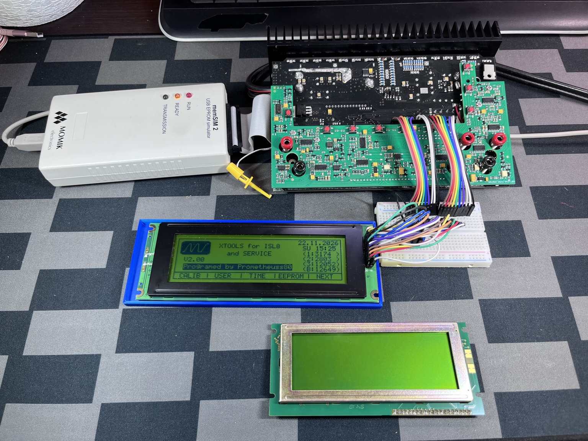

# Schulze ISL8-936G – SAP1024B LCD replacement patch



**[Česká dokumentace / Czech README](README_CS.md)**

This repository provides a **patch generator only** for the original **Schulze ISL8-936G / Chameleon, firmware 8.50 EN**. It replaces the unused factory calibration code area in the owner's original 64 KiB ROM with a custom driver for a 240×64 SAP1024B/T6963C-compatible LCD. The original factory calibration entry is explicitly disabled. It does **not** contain, redistribute, or download the proprietary ROM, reconstructed factory assembly, or any prepatched image.

The patch is based on the hardware-tested **PASS 10F** revision. The display operates **exclusively in graphical mode**, `FS = LOW/GND`, 8 pixels per RAM byte, using the original ROM-resident Schulze font plus custom replacements for the arrows and ampersand. This avoids 8-to-6-bit pixel repacking and hardware text/graphics mode switching. Rendering remains somewhat slower than the original LCD; the slow redundant screen-clearing pass has been eliminated.

## Files

- `patch_fw850en.py` – standalone Python 3.9+ patcher / driver generator; no external dependencies
- `README_CS.md` – full Czech readme
- `WIRING.md` – original-to-replacement LCD connector and MCU signal table
- `photos/sap1024b_running_in_isl8.jpg` – actual test photograph

## Generate a patched ROM locally

Obtain your own untouched **8.50 EN** EPROM image, named `fw850en.bin`, and run:

```bash
python patch_fw850en.py fw850en.bin --hex
```

Original input SHA-256 (strictly enforced):

`f9d461cb2541e4584cf9811e5b68850b6dd13b36725339e09f433699b96aa5ed`

Expected patched output SHA-256 (strictly verified):

`74a0654397cda82d4a91ed2c82aeb753bf158293ed8c8de81501636dd84a8020`

Output: `fw850en_sap1024b.bin` and `fw850en_sap1024b.hex`, generated only on your computer. The script does not overwrite the input ROM or write to any external hardware. Other firmware versions are rejected.

**Warning:** The original factory calibration code at `0x001E–0x08D1` is overwritten, and the entry at `0xBAF7` is disabled. This patch **cannot perform factory calibration**. Refer to [the full Czech documentation](README_CS.md) for technical details, limitations, and safety precautions.

For wiring details, see [WIRING.md](WIRING.md). The `FS` setting must be LOW/GND; confirm the actual jumper/pad location for your specific LCD revision. Verify contrast and supply pinouts rather than blindly reconnecting a different LCD module.

This is an independent hobbyist reverse-engineering and preservation project, not affiliated with Schulze. Code and documentation authored for this patch are MIT-licensed. No license for the original firmware or third-party hardware designs is implied.
