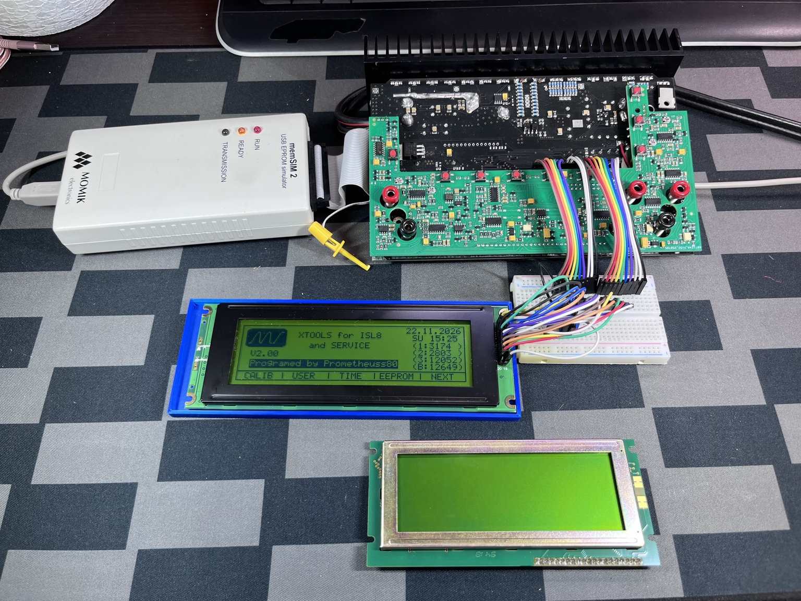

# Schulze ISL8-936G – náhrada původního LCD (SAP1024B)



Tento projekt dokumentuje **možnost náhrady původního grafického LCD** nabíječky **Schulze ISL8-936G (Chameleon)** displejem kompatibilním s řadičem **SAP1024B / T6963C**. Na fotografii je skutečný zkušební provoz v nabíječce, nikoliv simulace.

Základem je ověřená testovací varianta **PASS 10F**. Původní firmware zůstává z větší části zachován: nahrazena je *rutina tovární kalibrace* v ROM na adresách `001Eh–08D1h` novým LCD driverem, přesměrovány jsou vybrané vstupní body původní obsluhy LCD a zakázáno spuštění původní tovární kalibrace.

> **Pouze pro originální Schulze firmware 8.50 EN.** Projekt není univerzální aktualizace firmware ani nový servisní program. Původní firmware a jakékoliv hotové upravené BIN/HEX obrazy **nejsou součástí repozitáře**.

## Stav a rozsah

- SAP1024B, **jeden čistě grafický režim 240 × 64**, šířka 8 pixelů na byte (`FS = LOW / GND`).
- Softwarové vykreslování používá původní 5×7 font Schulze uložený v ROM a námi doplněné opravy speciálních znaků (`&`, šipky).
- Podpora původních obrazovek, grafů, znaků a obsluhy menu.
- Rychlé mazání celé grafické RAM pomocí `B0h` / `B2h`; zbytečné fyzické vykreslení **320 mazacích mezer** při průchodu `A_F770` je přeskočeno, zatímco zpracování původním firmwarem zůstává zachováno.
- Kreslení textu je pomalejší než na původním LCD s hardwarovým znakovým režimem. To je známý kompromis.
- Není vyžadován nový framebuffer ani rezervace oblasti XRAM.
- **Nebyla ověřena kompatibilita s jinou verzí firmware, jinou revizí LCD ani všemi dlouhodobými provozními stavy.**

## Obsah repozitáře

```text
ISL8_LCD_SAP1024B/
├── patch_fw850en.py        # náš kompletní generátor a patcher, bez ROM dat
├── README.md               # English
├── README_CS.md            # tento soubor
├── WIRING.md               # zapojení originálního a nového LCD
├── LICENSE                 # licence pouze pro náš kód a dokumentaci
├── .gitignore
└── photos/
    └── sap1024b_running_in_isl8.jpg
```

## Použití patcheru

Vyžaduje Python 3.9 nebo novější, bez externích knihoven.

1. Ze **své vlastní** původní nabíječky si opatřete nezměněný obsah EPROM firmware **8.50 EN** a uložte jej jako `fw850en.bin`.
2. Zkontrolujte kontrolní součet SHA-256 původního souboru:
   `f9d461cb2541e4584cf9811e5b68850b6dd13b36725339e09f433699b96aa5ed`
3. Spusťte:

```bash
python patch_fw850en.py fw850en.bin --hex
```

Vzniknou soubory `fw850en_sap1024b.bin` a `fw850en_sap1024b.hex`, pouze v lokální složce. Originální `fw850en.bin` zůstává beze změny. Výstup PASS 10F má SHA-256:

`74a0654397cda82d4a91ed2c82aeb753bf158293ed8c8de81501636dd84a8020`

Pro vlastní umístění výstupu:

```bash
python patch_fw850en.py fw850en.bin -o output.bin --hex
```

Skript ověřuje velikost, přesný SHA-256 originálního obrazu, očekávané instrukce v patchovaných místech a výsledný kontrolní součet. Na jiném firmware se **zastaví bez vytvoření výstupu**. Neprovádí žádný zápis přímo do nabíječky.

## Paměťová mapa a zásahy

| Oblast / adresa | Úprava |
|---|---|
| `001Eh–08CEh` | Vlastní SAP1024B driver, grafický fontový rasterizér a rychlé mazání |
| `08CFh–08D1h` | Bezpečnostní `LJMP 0000h` |
| `BAF7h` | Původní volání tovární kalibrace deaktivováno (`NOP NOP NOP`) |
| `FD96h` | Vstup do inicializace nového LCD |
| `E336h`, `F925h`, `F9BAh`, `F9D7h` | Přesměrování základních grafických operací |
| `EB70h`, `EEB3h`, `F770h` | Přesměrování textového vykreslení a optimalizace mazání |
| `FDA5h`, `F943h`, `FB6Fh` | Úpravy původní LCD obsluhy / čekání |

Přesný seznam patchovacích operací je přímo v čitelném zdrojovém kódu `patch_fw850en.py`. Původní kalibrační kód v uvedené oblasti je přepsán; starou tovární kalibraci nelze s tímto patchem spustit. Pro kalibraci je nutné použít jiný, samostatný servisní postup, nikoliv tento LCD patch.

## Zapojení

Podívejte se na [WIRING.md](WIRING.md). Nezaměňovat logické signály a vývody napájení nebo kontrastu. SAP1024B používá původní 8bitovou sběrnici procesoru `P5`, ale mění se význam některých signálů `P6`.

**FS musí být LOW / GND** (8 grafických pixelů na byte, 30 bytů na řádek). Nastavení závisí na konkrétní revizi modulu a nemusí být vyvedeno na standardní dvacetipinový konektor.

## Bezpečnost a odpovědnost

Úprava není výrobkem ani oficiální aktualizací společnosti Schulze. Provádějte ji jen s ověřenou verzí hardware a s odpojenými akumulátory a výkonovou zátěží při prvním oživení. Změna způsobu zobrazení sama o sobě nezaručuje bezpečný provoz nabíječky. Zachovejte zálohu původní EPROM a ověřte všechny ochranné a provozní stavy.

## Licence a práva

Publikován je **pouze nově napsaný patchovací kód, dokumentace a vlastní ukázková fotografie**. Firmware Schulze, jeho rekonstrukce v ASM, původní kalibrační kód, datasheety a jiné soubory třetích stran nejsou součástí. Licence MIT se vztahuje pouze na vlastní publikovaný obsah; žádná licence ke kódu Schulze tím nevzniká.
