# XTOOLS for ISL8 and SERVICE

**Independent service and hardware-control firmware for the Schulze ISL8-936G (Chameleon) battery charger.**

> **Status: Work in progress / experimental.** This is an independently developed research and service project, not official Schulze firmware. It is intended for technically qualified users with appropriate measurement equipment. Not all functions or safety conditions have been validated.

[Česká dokumentace](README_CS.md)

## Overview

XTOOLS is a standalone firmware application developed for the ISL8-936G's Infineon/Siemens 80C537 (8051-family) microcontroller. It initializes the CPU and charger hardware, presents a graphical service interface, provides diagnostics, and experimentally controls the charger's hardware without relying on the original application firmware.

The main objective is to understand and document the ISL8-936G hardware from initialization through monitoring and control of its peripherals and three charging/discharging ports.

## Features

- **Standalone startup:** microcontroller, watchdog, hardware and safe-state initialization.
- **Dual graphic LCD support:** original HD61830-compatible display and replacement SAP1024B display; select a backend in `config.h` and build the same Keil C51 project.
- **Custom graphics/UI:** graphical LCD drawing, font handling, display pages, keypad input and piezo feedback.
- **ADC and measurements:** raw ADC readings, voltage/current measurement and calibration-related calculations.
- **Calibration service:** inspect and adjust A1, A2, A3, and BATT+ voltage calibration values in the battery-backed Timekeeper.
- **M48T08 Timekeeper and RTC:** inspect redundant stored data, check consistency, read/set RTC, and provide service reset operations for user information.
- **Serial number checks:** compare and inspect serial-number data recorded in different non-volatile memories.
- **EEPROM service:** read, inspect and write the on-board serial EEPROM, including service views and diagnostic routines.
- **Hardware peripheral tests:** switch selected charger peripherals and test external/internal control signals, fan controls and test outputs.
- **Three independent port test screens:** experimental control and measurement of A1, A2 and A3 charge/discharge behavior according to each port's hardware capabilities.
- **Diagnostics:** serial status output, keyboard processing, watchdog handling and hardware-state checks.

These capabilities are represented in the current source tree. Their implementation maturity and hardware validation differ by function.

## Building

Open `XTOOLS_ISL8_SERVICE.uvproj` with a compatible Keil µVision/C51 toolchain. Set the display controller in `config.h`. The local installation must provide `REG537.H` with compatible register definitions; the vendor-supplied `STARTUP.A51` and register header from the working folder are deliberately **not** redistributed. Check and configure startup in Keil before building. This export has not been rebuilt or hardware-tested.

## Hardware and toolchain

- Target charger: **Schulze ISL8-936G (Chameleon)**
- MCU: **80C537 (8051 architecture)**
- Nonvolatile / RTC device: **M48T08 Timekeeper**
- Development environment: **Keil µVision / C51**, including C and A51 assembly modules
- Displays: original **HD61830-compatible LCD** and replacement **SAP1024B LCD**

### LCD backend selection

In `config.h`, select one controller:

```c
#define LCD_CONTROLLER LCD_CONTROLLER_HD61830
```

or

```c
#define LCD_CONTROLLER LCD_CONTROLLER_SAP1024B
```

Only one backend is active per firmware build. The replacement LCD's bit-order setting is also configurable in `config.h`.

## Source organization

The existing canonical source filenames are preserved:

| Area | Files |
|---|---|
| Core and hardware | `main.c`, `system.c`, `hardware.c`, `config.h` |
| LCD and GUI | `lcd.c`, `lcd_hd61830.c`, `lcd_sap1024b.c`, `lcd_font.c`, `lcd_bitmap.c`, `gui.c` |
| Measurement and power | `adc.c`, `measurement.c`, `charge.c`, `battery_protection.c` |
| Nonvolatile service | `timekeeper.c`, `eeprom.c`, `eeprom_asm.a51` |
| Peripherals | `keyboard.c`, `sound.c`, `internalfan.c`, `test5v.c` |
| System service | `watchdog.c`, `watchdog_asm.a51`, `serial.c`, `service.c` |
| Project file | `XTOOLS_ISL8_SERVICE.uvproj` |

## Development status

This repository is an **ongoing hardware reverse-engineering and service development project**. Many primary subsystems have been developed and tested on the actual charger, but this does **not** imply the tool is production-ready. In particular, power-path control, abnormal input conditions, thermal protection, nonvolatile-memory writes, and all charger operating modes require careful validation.

## Safety

**Warning: This firmware directly controls power electronics and can alter stored calibration, configuration, and identity data. Incorrect use can damage the charger, connected batteries, power supplies, or other equipment, and can create a fire risk.**

- Test only on an instrumented bench with suitable current limiting and independent voltage/current monitoring.
- Never assume software-only limits are sufficient safety protection.
- Back up the complete Timekeeper and EEPROM before making any changes.
- Do not attach unattended or valuable battery packs to experimental firmware.
- Verify the LCD backend and target hardware configuration before programming.

## Publication and third-party materials

This publication copy excludes the original Schulze firmware dumps and generated binaries, the Keil-copyrighted register header and startup module, and the manufacturer ROM logo. The logo drawing has been replaced by a newly authored XTOOLS graphic. Source files use the Keil-provided `<REG537.H>`; ensure this header is available in your installation and defines all required 80C537 registers. The project may also require startup configuration from your local Keil toolchain. A clean rebuild has **not** been verified.

The original manufacturer's names are used for hardware identification only; this project is independent and unaffiliated.

## License

**Not yet selected.** Add an appropriate license only after confirming rights for every included source file. Original firmware and vendor-supplied modules are not part of this package.

## Two LCD firmware variants / Dvě varianty firmware LCD

One Keil C51 project contains two build targets, with the same source files:

| Target | Controller | Expected build output |
|---|---|---|
| `XTOOLS_HD61830` | original HD61830 | `Objects/HD61830/XTOOLS_ISL8_HD61830.hex` |
| `XTOOLS_SAP1024B` | replacement SAP1024B | `Objects/SAP1024B/XTOOLS_ISL8_SAP1024B.hex` |

Select **Project → Batch Build** and select both targets to generate both HEX
files using a local Keil C51 installation. No HEX file is included in this
source distribution, and these builds have not been verified here.

The project now uses a project-owned `xtools_boot.a51` startup entry rather
than bundling a vendor-provided STARTUP.A51. It clears internal RAM 00h–7Fh,
sets the stack using the linker-provided `?STACK` segment, and transfers to
Keil's `?C_START` runtime initializer. It intentionally does not clear XDATA
or the Timekeeper. This still **depends on the Keil C51 runtime** and must be
checked with a real compiler/linker build before flashing.

**Česky:** V Keilu zvolte `Project → Batch Build` a oba cíle. Každý má
samostatný výstupní HEX soubor. Soubor `xtools_boot.a51` je náš vlastní
startovací modul; neobsahuje kód převzatý z dodávky Keil. Bez úspěšného
překladu a testu na hardware nelze sestavení považovat za ověřené.

## Project photographs

These twelve photographs document XTOOLS running on actual ISL8-936G hardware, including service diagnostics, independent port test screens and a replacement LCD. The photos show development/test states, not a validated release.

| | |
|---|---|
| **01. Main menu**<br>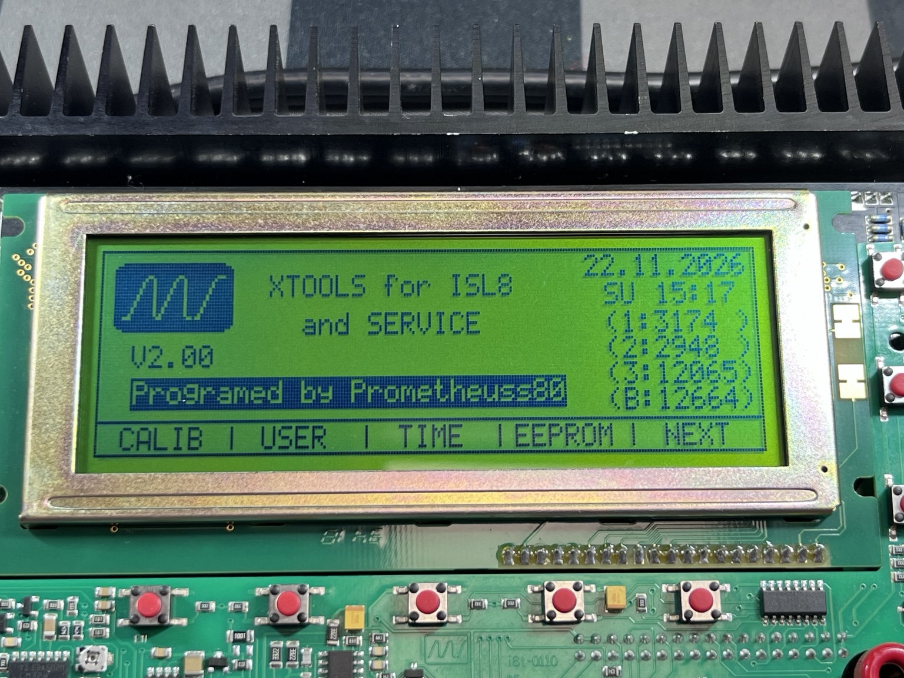 | **02. Calibration**<br>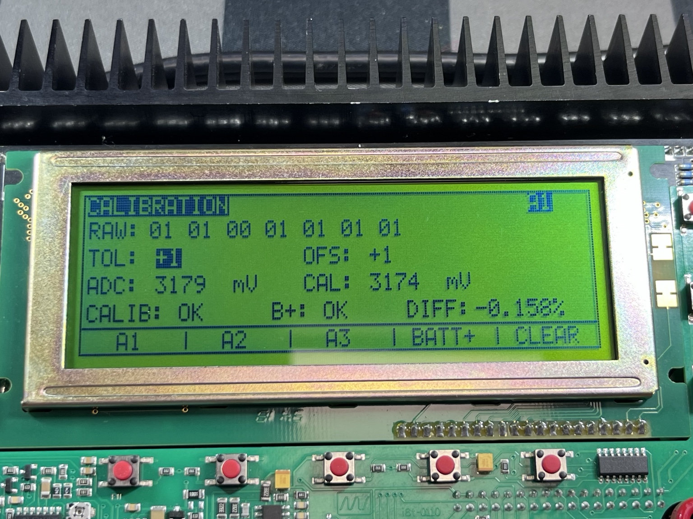 |
| **03. User / password and serial number**<br>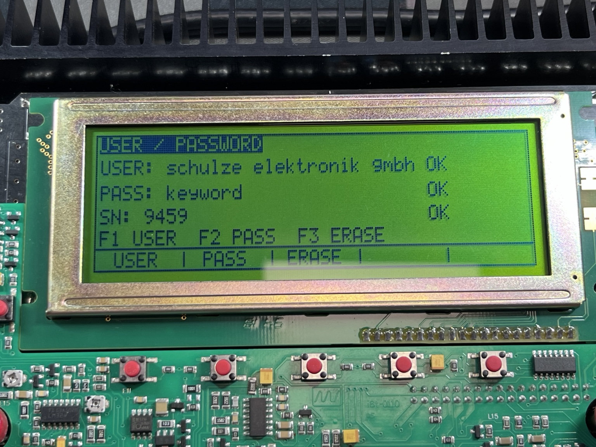 | **04. RTC date and time**<br>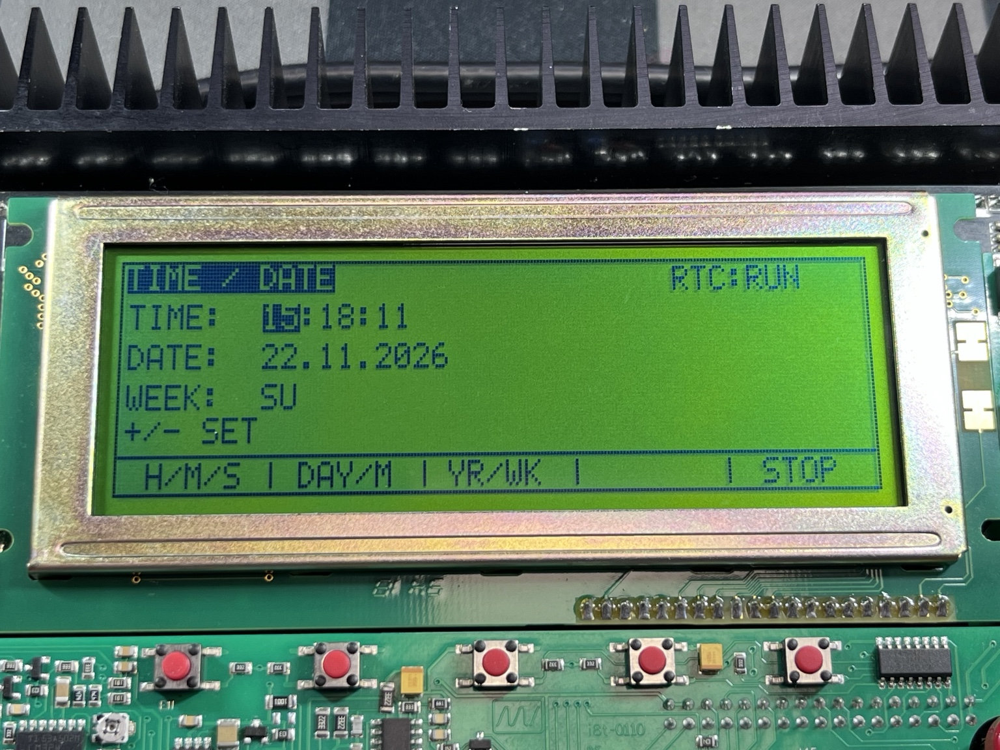 |
| **05. EEPROM diagnostics and serial number comparison**<br>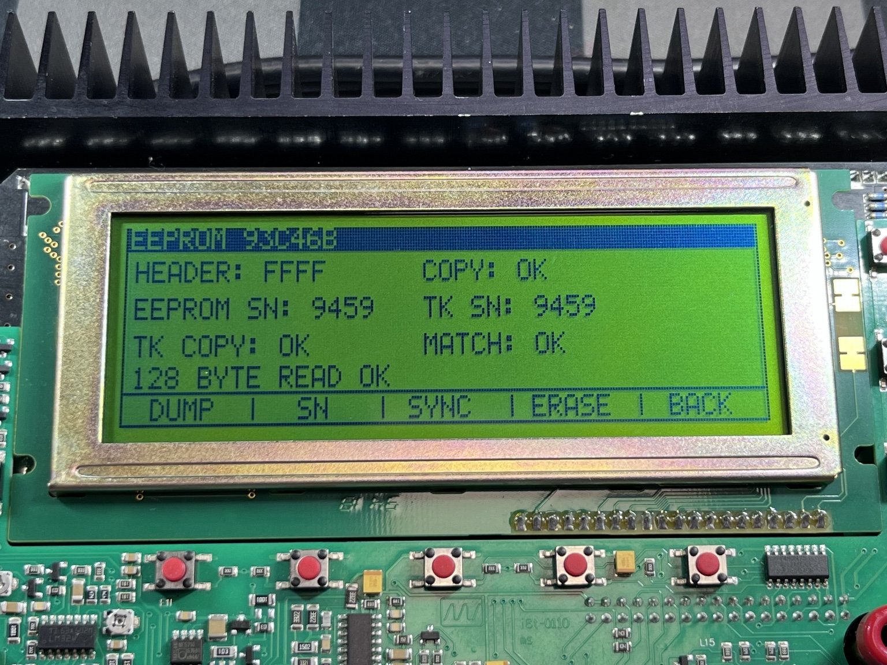 | **06. EEPROM hexadecimal dump**<br>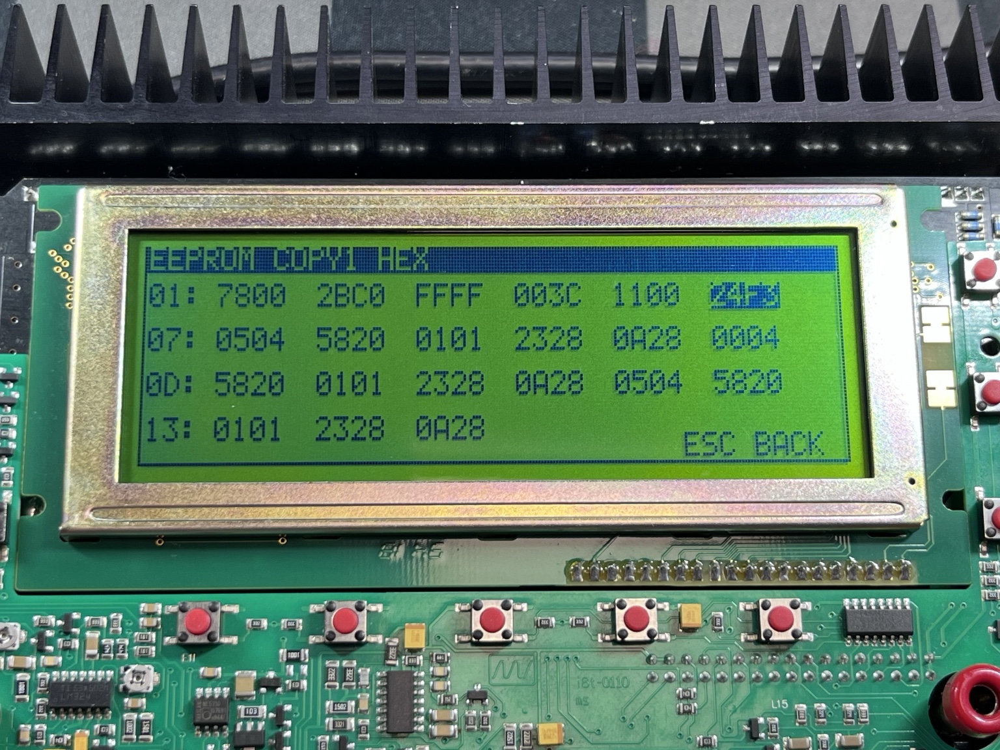 |
| **07. Hardware peripheral tests**<br>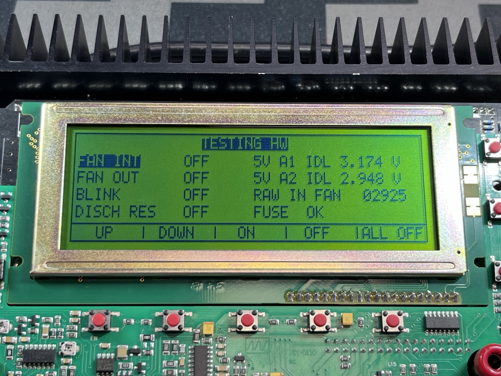 | **08. Port A1 test**<br>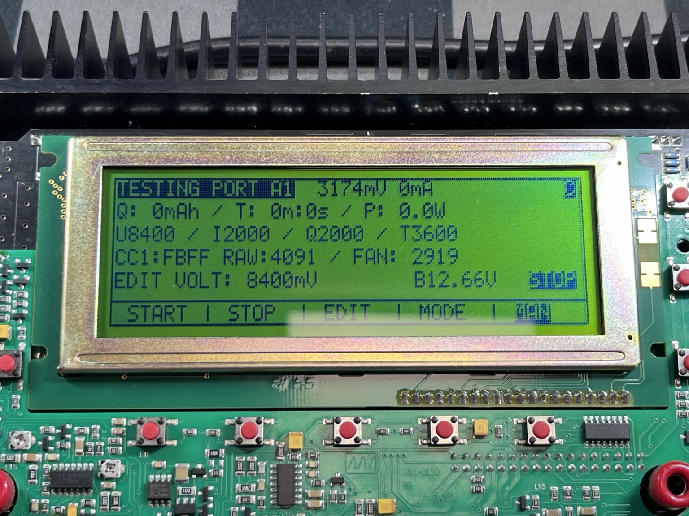 |
| **09. Port A2 test**<br>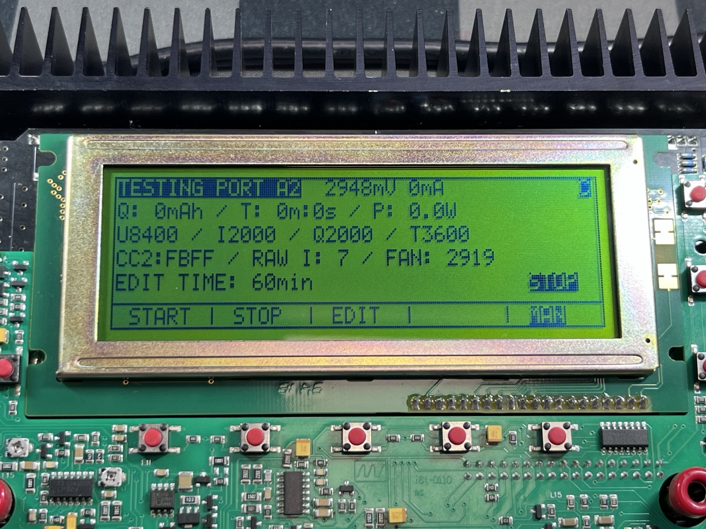 | **10. Port A3 test**<br>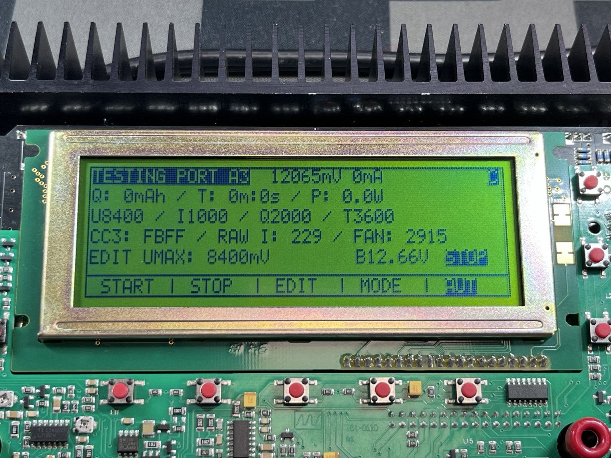 |
| **11. Combined charge diagnostics**<br>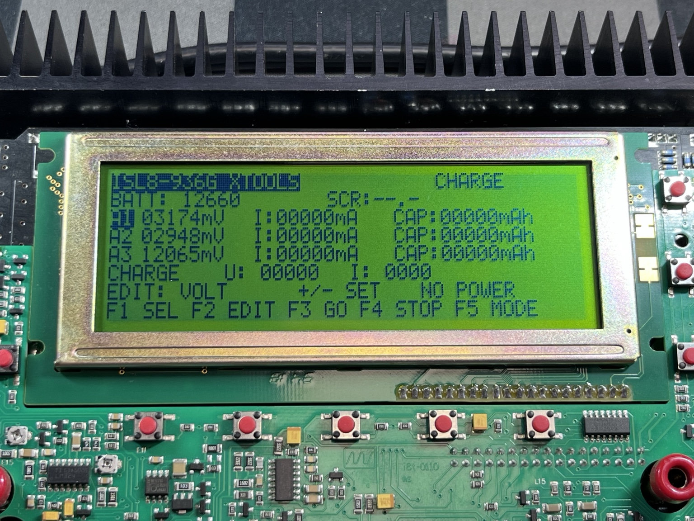 | **12. Replacement LCD running XTOOLS on a test bench**<br>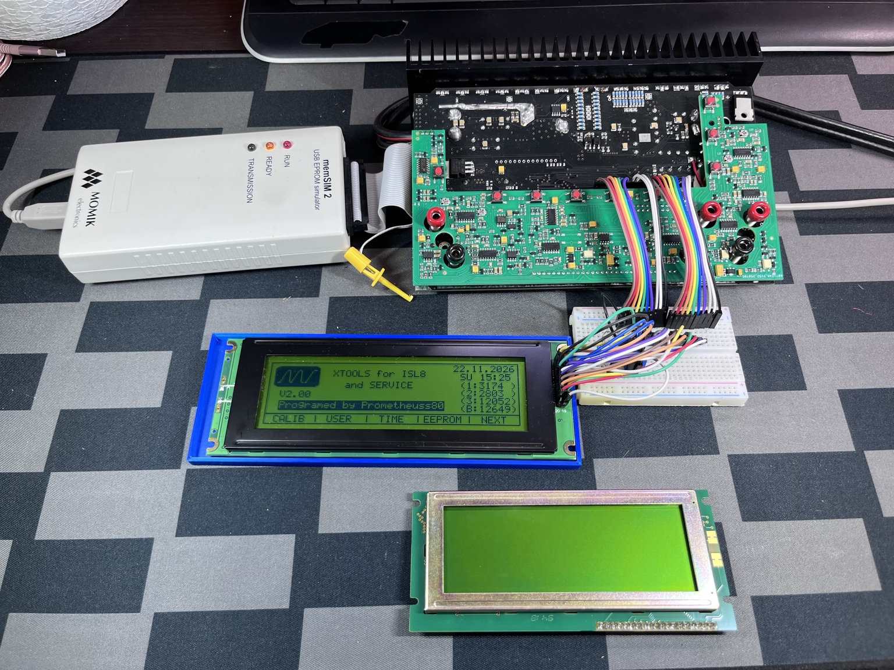 |

**Publication note:** The user/password screen and serial-number diagnostics show information stored on the test device. Verify that it is suitable for public sharing before publishing.
