# XTOOLS for ISL8 and SERVICE

**Nezávislý servisní a diagnostický firmware pro nabíječ Schulze ISL8-936G (Chameleon).**

> **Stav: rozpracovaný projekt (Work in Progress).** Jde o vlastní vývoj, nikoliv o oficiální firmware Schulze. Řada funkcí již byla vyzkoušena na skutečném zařízení, ale některé režimy, ochrany a chybové stavy zatím nejsou plně ověřeny.

[English README](README.md)

## O projektu

XTOOLS je samostatný program pro procesor **80C537** (rodina 8051), vytvořený v prostředí **Keil µVision / C51**. Provádí inicializaci procesoru, LCD a periferií nabíječe, umožňuje měření a diagnostiku a slouží jako vývojový nástroj pro zkoumání i vlastní řízení hardwaru ISL8-936G.

Program nevyžaduje běh původního aplikačního firmware. Cílem projektu je postupně zdokumentovat a ovládnout hardware nabíječe od základní inicializace až po řízení výkonových obvodů.

## Funkce

- **Inicializace HW:** konfigurace CPU, časovačů, watchdogu, portů a definování výchozího bezpečného stavu.
- **Grafický LCD:** vlastní grafický buffer, vykreslování textu a grafiky, obsluha uživatelských servisních obrazovek.
- **Dva LCD řadiče:** původní **HD61830** a náhradní **SAP1024B**; volba v `config.h`.
- **Klávesnice a piezo:** čtení tlačítek, obsluha stisků a akustické signalizace.
- **ADC:** čtení surových hodnot, měření napětí a vybraných proudů, kalibrační výpočty.
- **Kalibrace:** čtení a změna kalibračních údajů kanálů A1, A2, A3 a BATT+ v Timekeeperu.
- **M48T08 a RTC:** čtení uložených dat, jejich kontrola, nastavení data a času, servisní operace s uživatelskými údaji.
- **EEPROM:** čtení, zápis a diagnostika externí EEPROM, včetně kontroly a porovnávání sériového čísla s údaji v Timekeeperu.
- **Testy periferií:** spínání vybraných externích obvodů, ovládání ventilátoru a diagnostických signálů.
- **Porty A1, A2, A3:** samostatné servisní režimy pro experimentální nabíjení a vybíjení podle možností jednotlivých portů.
- **Sériová komunikace a watchdog:** pomocné diagnostické a servisní rutiny.

Rozsah implementace a míra ověření se liší mezi funkcemi. Přítomnost funkce ve zdrojových souborech sama o sobě neznamená její úplné dokončení.

## Hardware a vývojové prostředí

| Část | Použitý hardware / software |
|---|---|
| Nabíječ | Schulze ISL8-936G (Chameleon) |
| Procesor | Siemens/Infineon 80C537, architektura 8051 |
| Zálohovaná paměť a RTC | M48T08 Timekeeper |
| Vývojové prostředí | Keil µVision, kompilátor C51, assembler A51 |
| LCD – původní | HD61830-kompatibilní |
| LCD – náhradní | SAP1024B |

### Volba LCD

Soubor `config.h` obsahuje volbu řadiče:

```c
#define LCD_CONTROLLER LCD_CONTROLLER_HD61830
```

nebo:

```c
#define LCD_CONTROLLER LCD_CONTROLLER_SAP1024B
```

V jedné přeložené verzi programu je aktivní jeden řadič. Oba ovladače zůstávají součástí stejného projektu.

## Přehled zdrojových souborů

| Oblast | Hlavní soubory |
|---|---|
| Základ programu a hardware | `main.c`, `system.c`, `hardware.c`, `config.h` |
| LCD a obrazovky | `lcd.c`, `lcd_hd61830.c`, `lcd_sap1024b.c`, `lcd_font.c`, `lcd_bitmap.c`, `gui.c` |
| ADC a regulace | `adc.c`, `measurement.c`, `charge.c`, `battery_protection.c` |
| Trvalá paměť | `timekeeper.c`, `eeprom.c`, `eeprom_asm.a51` |
| Klávesnice a další periferie | `keyboard.c`, `sound.c`, `internalfan.c`, `test5v.c` |
| Servisní funkce | `watchdog.c`, `watchdog_asm.a51`, `serial.c`, `service.c` |
| Projekt Keil | `XTOOLS_ISL8_SERVICE.uvproj` |

## Sestavení

Projekt otevřete pomocí `XTOOLS_ISL8_SERVICE.uvproj` v kompatibilní verzi Keil µVision / C51. Nejdříve nastavte variantu LCD v `config.h`.

Původně přiložený `REG80C537_ISL8.h` obsahoval hlavičku s copyrightem Keil. Ve veřejné kopii byl odstraněn a odkazy přesměrovány na standardní **`REG537.H`** z lokální instalace Keil. Je nutné ověřit, zda instalovaná verze obsahuje odpovídající definice registrů 80C537.

Z publikační kopie byl rovněž vynechán původní modul `STARTUP.A51` dodaný firmou Keil. Před překladem je potřeba nakonfigurovat startovací kód poskytovaný vlastní instalací vývojového prostředí. **Tato exportovaná verze nebyla znovu přeložena ani otestována na hardware.**

## Zveřejněné a vynechané soubory

Zveřejněny jsou zdrojové soubory projektu se zachovanými původními názvy. Původní binární firmware Schulze, binární výstupy sestavení, výpisy, dočasné soubory prostředí Keil a proprietární části vývojového prostředí nejsou součástí veřejného balíčku.

Původní bitmapa loga získaná z ROM byla nahrazena **vlastním jednoduchým symbolem XTOOLS (43 × 22 pixelů)**. Název funkce `LCD_DrawSchulzeLogo()` zůstává pouze kvůli kompatibilitě se stávajícím GUI.

## Bezpečnost

**Pozor:** Program přímo ovládá výkonové části nabíječe a může měnit kalibraci, nastavení i identifikační data v pamětech. Nesprávné použití může poškodit nabíječ, akumulátory nebo další zařízení a může způsobit požár.

- Testujte pouze na vybaveném pracovišti s nezávislým měřením a omezením proudu.
- Před zápisem vždy zálohujte obsah Timekeeperu a EEPROM.
- Nedůvěřujte samotným programovým limitům jako jediné ochraně.
- Nepoužívejte experimentální firmware pro nabíjení bez dozoru.
- Před spuštěním vždy ověřte správnou konfiguraci HW a LCD.

## Stav projektu a licence

Projekt je aktivně rozvíjen a má především výzkumný, diagnostický a servisní účel.

**Licence zatím není zvolena.** Před jejím doplněním je nutné ověřit oprávnění ke všem zahrnutým souborům. Projekt není přidružen k výrobci Schulze; názvy výrobce a výrobku jsou uvedeny pouze k identifikaci podporovaného hardware.

## Two LCD firmware variants / Dvě varianty firmware LCD

One Keil C51 project contains two build targets, with the same source files:

| Target | Controller | Expected build output |
|---|---|---|
| `XTOOLS_HD61830` | original HD61830 | `Objects/HD61830/XTOOLS_ISL8_HD61830.hex` |
| `XTOOLS_SAP1024B` | replacement SAP1024B | `Objects/SAP1024B/XTOOLS_ISL8_SAP1024B.hex` |

Select **Project → Batch Build** and select both targets to generate both HEX
files using a local Keil C51 installation. No HEX file is included in this
source distribution, and these builds have not been verified here.

The project now uses a project-owned `xtools_boot.a51` startup entry rather
than bundling a vendor-provided STARTUP.A51. It clears internal RAM 00h–7Fh,
sets the stack using the linker-provided `?STACK` segment, and transfers to
Keil's `?C_START` runtime initializer. It intentionally does not clear XDATA
or the Timekeeper. This still **depends on the Keil C51 runtime** and must be
checked with a real compiler/linker build before flashing.

**Česky:** V Keilu zvolte `Project → Batch Build` a oba cíle. Každý má
samostatný výstupní HEX soubor. Soubor `xtools_boot.a51` je náš vlastní
startovací modul; neobsahuje kód převzatý z dodávky Keil. Bez úspěšného
překladu a testu na hardware nelze sestavení považovat za ověřené.

## Fotografie projektu

Těchto dvanáct fotografií dokumentuje skutečný běh XTOOLS na hardware ISL8-936G: servisní diagnostiku, samostatné obrazovky testů portů a nový LCD. Jde o vývojové a testovací stavy, nikoliv o potvrzení finálního vydání.

| | |
|---|---|
| **01. Hlavní nabídka**<br>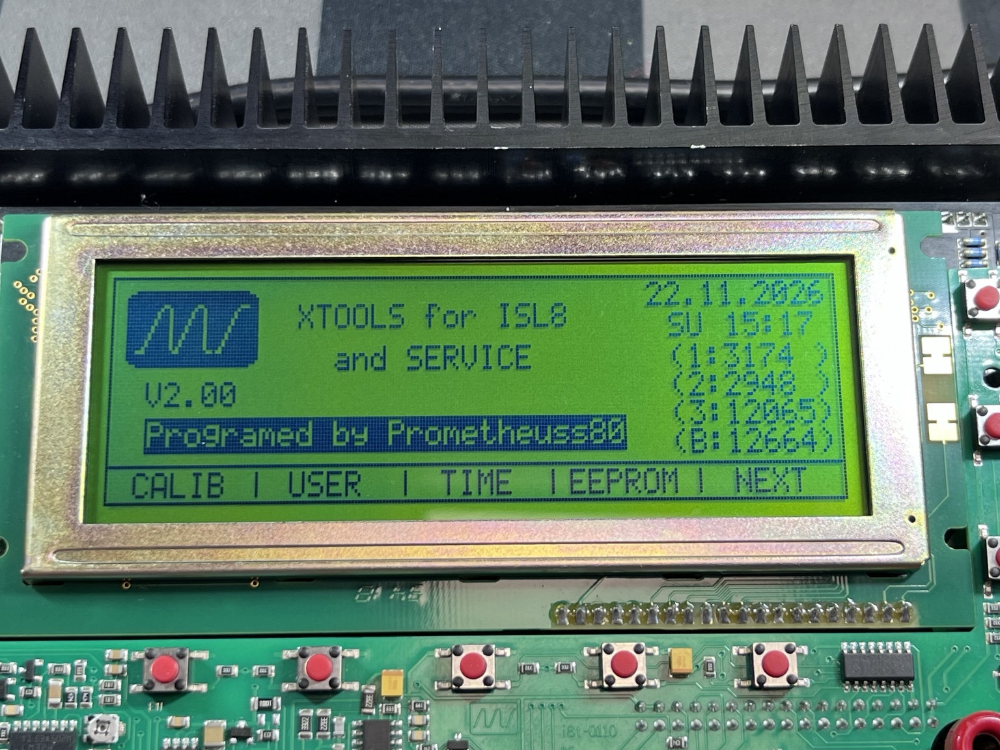 | **02. Kalibrace**<br>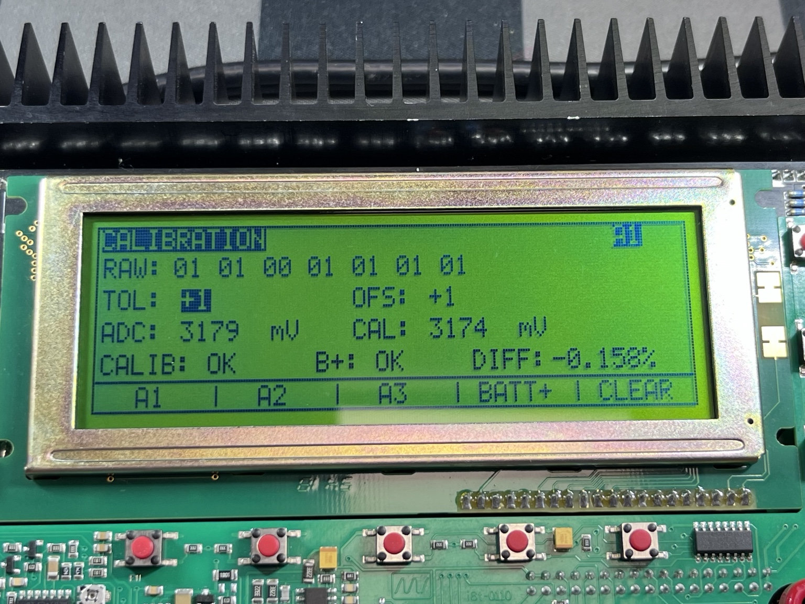 |
| **03. Uživatel / heslo a sériové číslo**<br>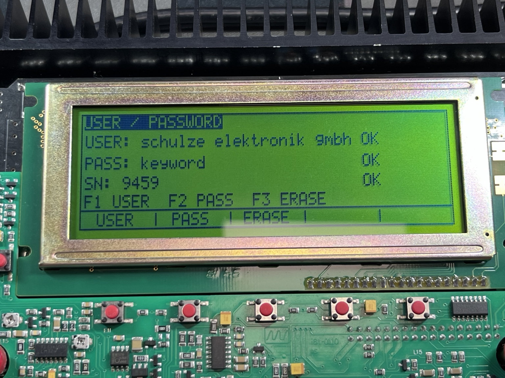 | **04. Datum a čas RTC**<br>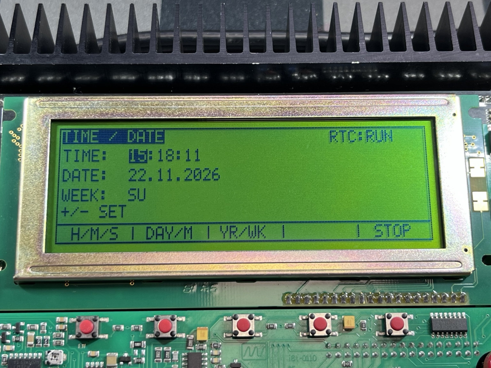 |
| **05. Diagnostika EEPROM a porovnání sériových čísel**<br>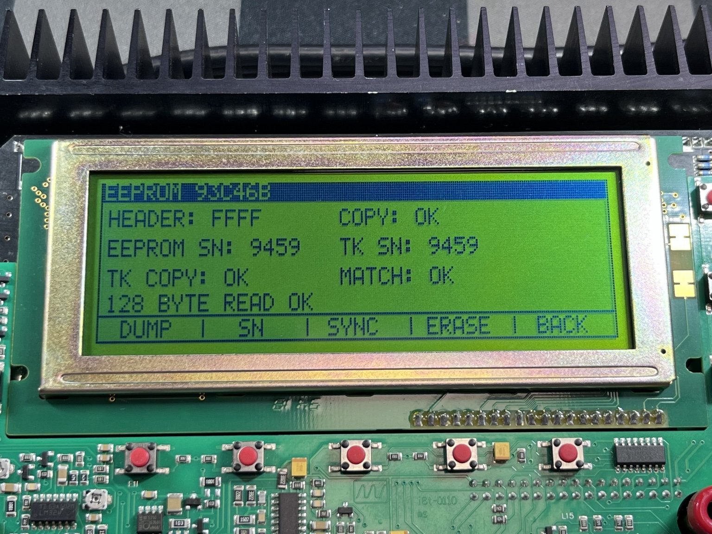 | **06. Hexadecimální výpis EEPROM**<br>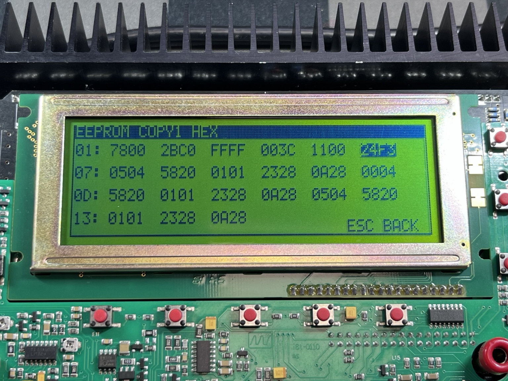 |
| **07. Testy hardwarových periferií**<br>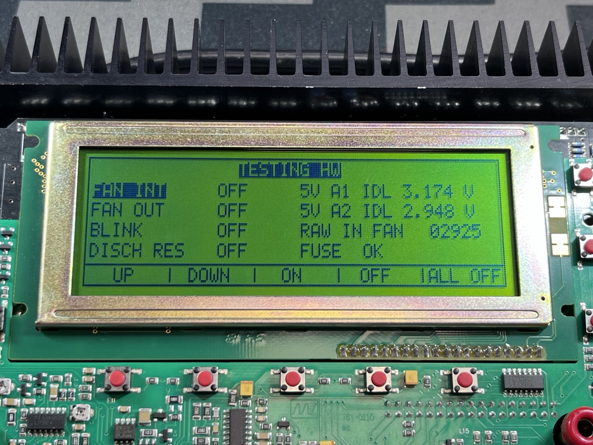 | **08. Test portu A1**<br>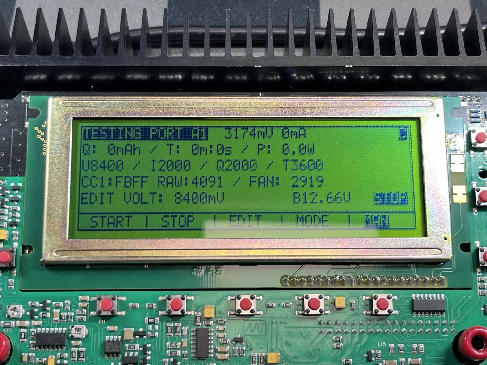 |
| **09. Test portu A2**<br>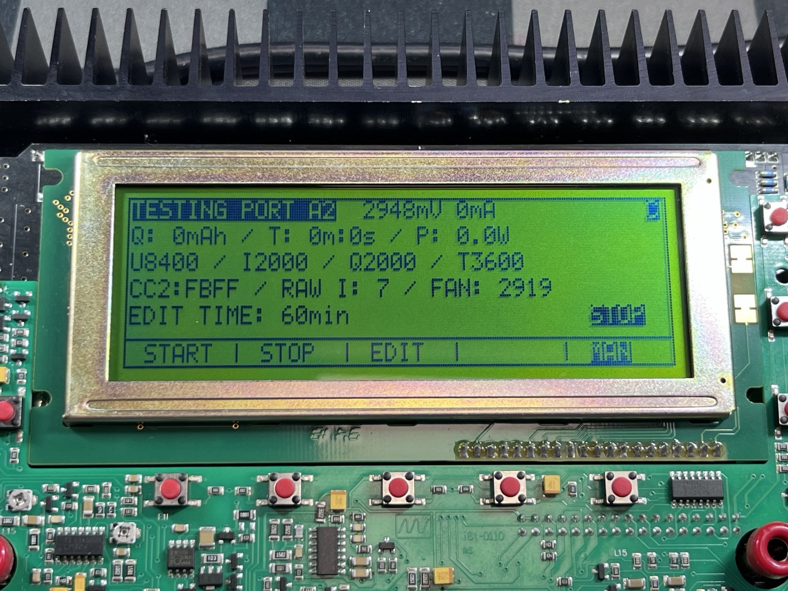 | **10. Test portu A3**<br>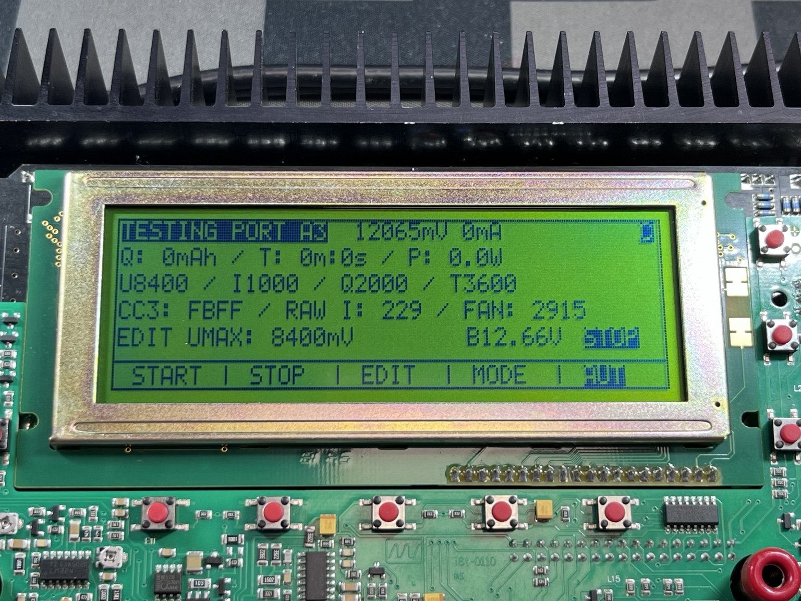 |
| **11. Souhrnná diagnostika nabíjení**<br>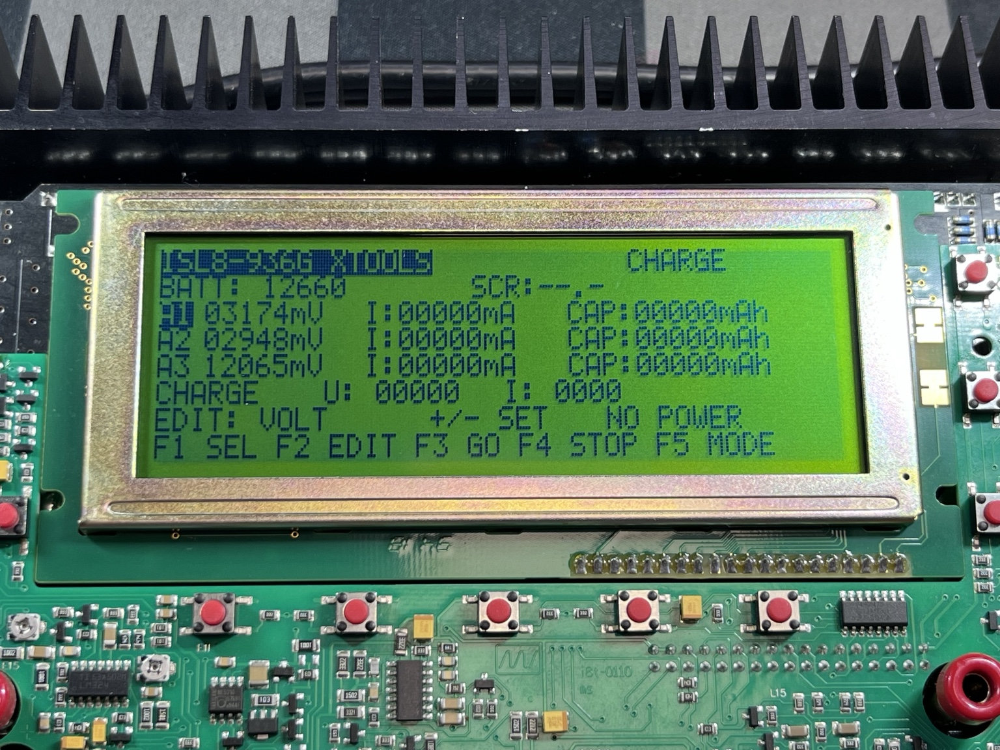 | **12. Nový LCD s běžícím XTOOLS na testovacím pracovišti**<br>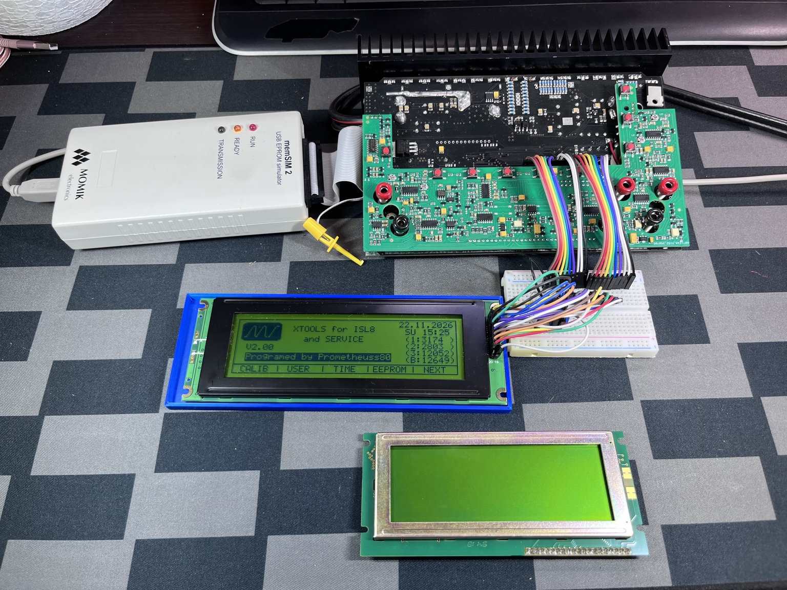 |

**Poznámka před zveřejněním:** Na obrazovce uživatele/hesla a v diagnostice sériových čísel jsou vidět údaje testovaného zařízení. Před publikováním ověřte, že je lze veřejně sdílet.
