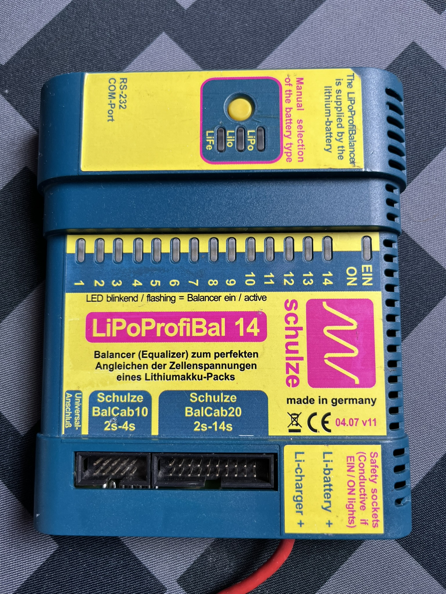
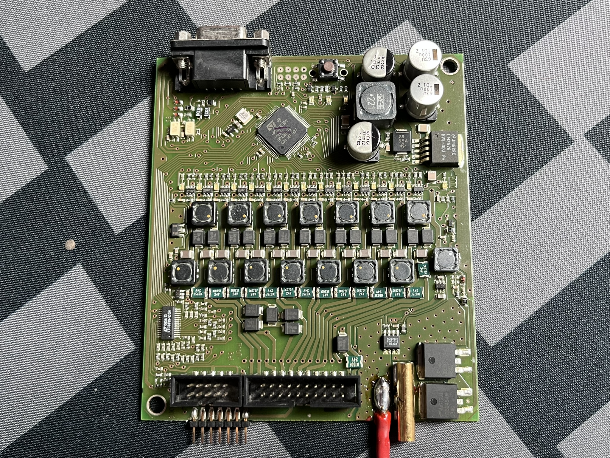

# LipoProfiBal06 — Firmware

**Work in Progress (WIP) · experimental MicroPython firmware · not validated for battery use**

Firmware development snapshot for **LipoProfiBal06**, a six-cell battery-balancer project built around **Raspberry Pi Pico** and the **ADS131M08** ADC.

[Česká dokumentace / Czech README](README_CS.md) · [Project status](STATUS.md)

## Repository contents

`SW/` contains the original MicroPython source files, preserving their filenames and structure. **Hardware files, EAGLE schematics/PCB files, and external EAGLE libraries are not included. The two photographs below show the earlier Schulze LipoProfiBal14 as a hardware reference, NOT a built LipoProfiBal06 prototype.** The firmware is shared independently while the hardware design remains private.

This is a source snapshot rather than an installable, tested release. An obsolete `pinout_pico.txt` file was deliberately omitted: the current pin assignments are in `SW/config.py` and `SW/adc.py`.

## Hardware reference photographs

The images document the original **Schulze LipoProfiBal14**, which informs the ongoing reverse-engineering and LipoProfiBal06 design. They **do not depict a completed LipoProfiBal06 prototype**. No EAGLE source files or library data are distributed here.

| Original enclosure | Original PCB |
|---|---|
|  |  |

## Pin assignment (defined in firmware)

| Function | Raspberry Pi Pico GPIO |
|---|---|
| UART TX / RX | GP0 / GP1 |
| Six cell PWM outputs | GP2–GP7 |
| ADS131M08 DRDY / CS | GP8 / GP9 |
| ADS131M08 SCLK / MOSI / MISO | GP10 / GP11 / GP12 |
| Cell LED 1 / 2 | GP14 / GP15 |
| I²C SDA / SCL | GP16 / GP17 |
| Cell LEDs 3–6 | GP18–GP21 |
| READY LED | GP22 |
| Debug LED | GP25 |
| MENU / SET buttons | GP26 / GP27 |
| ADS131M08 CLKIN | GP28 |

**GP15 is assigned to cell LED 2.** GP13, GP23 and GP24 are not assigned by these two configuration modules. This table is based on software, **not independently validated against PCB wiring**.

## Firmware configuration

| Parameter | Setting |
|---|---|
| Hardware version / firmware version | `1.00` / `1.00` |
| Firmware build / serial | `1` / `1` |
| Supported cells (configuration) | up to 6 |
| OLED | 128 × 64 |
| UART | 9600 baud |
| PWM | 80 kHz |
| ADC | ADS131M08, SPI1 |
| ADC input clock | 8.192 MHz |
| ADC SPI clock | 2 MHz |
| ADC frame | 10 × 24-bit words = 30 bytes |

The ADC driver separates CONFIG mode (ADC channels disabled, register access without DRDY dependency) from RUN mode (`Task()` handles DRDY and complete frames). These are source-code descriptions, not a verification of all runtime behavior.

## Development status and safety

The firmware is **in progress** and has not been validated as a complete, fail-safe balancing system. Incorrect battery management can cause cell damage, overheating or fire. Do not deploy or use with batteries without an independent electrical and safety review, tested limits, protection mechanisms and controlled validation.

## Copyright and reuse

Original project code is provided by its author. **No open-source license has been selected yet; availability on GitHub alone does not grant reuse or redistribution rights.** The bundled `SW/ssd1306.py` is based on the official MicroPython SSD1306 driver distributed under the MIT license; attribution and license notice are provided in [THIRD_PARTY_LICENSES.md](THIRD_PARTY_LICENSES.md). Original project firmware has no repository-wide open-source license selected yet.
