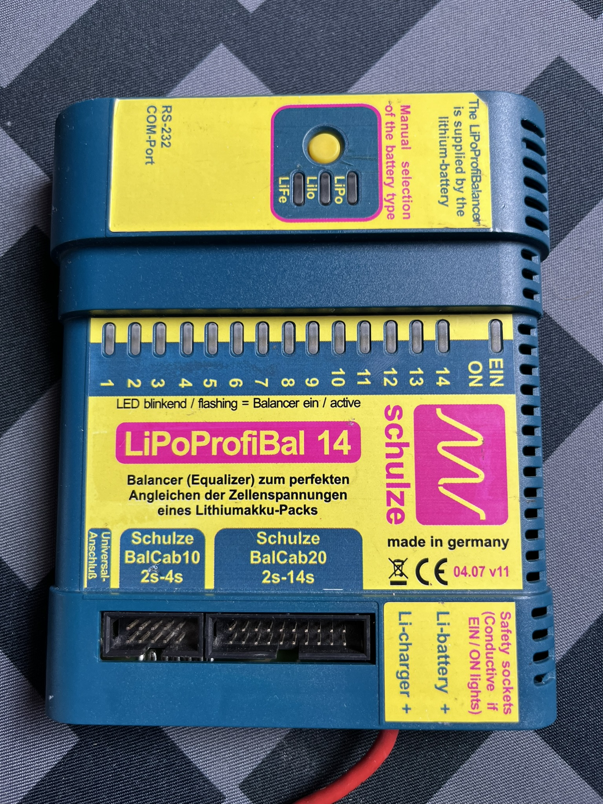
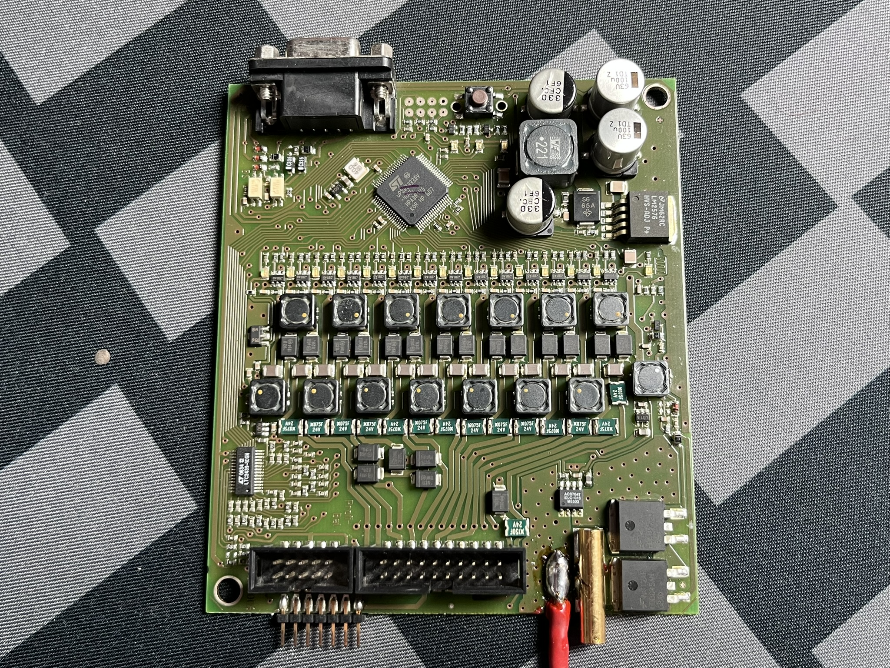

# LipoProfiBal06 — Firmware

**Rozpracovaný projekt (Work in Progress / WIP) · experimentální MicroPython firmware**

Vývojová verze firmwaru pro **LipoProfiBal06**, balancér až šesti článků postavený na **Raspberry Pi Pico** a převodníku **ADS131M08**.

[English README](README.md) · [Stav projektu](STATUS.md)

## Obsah repozitáře

Ve složce `SW/` jsou původní zdrojové soubory MicroPythonu se zachovanými názvy. **Hardwarová část (schéma, DPS EAGLE, a knihovny) není zveřejněna. Přiložené dvě fotografie zobrazují starší originální Schulze LipoProfiBal14 jako referenci, nikoliv hotový prototyp LipoProfiBal06.** Vývoj HW pokračuje mimo veřejný repozitář.

Jde o vývojový snapshot zdrojového kódu, nikoli o kompletní ověřenou verzi pro provoz. Starý soubor `pinout_pico.txt` byl záměrně vyřazen. Platné konfigurace pinů jsou v `SW/config.py` a `SW/adc.py`.

## Referenční fotografie hardwaru

Fotografie zachycují původní **Schulze LipoProfiBal14**, který slouží jako technická reference při vývoji. **Nejde o fotografie dokončeného LipoProfiBal06.** Schéma, DPS ani knihovny EAGLE se nezveřejňují.

| Původní přístroj | Původní DPS |
|---|---|
|  |  |

## Aktuální pinout podle firmwaru

| Funkce | GPIO Raspberry Pi Pico |
|---|---|
| UART TX / RX | GP0 / GP1 |
| Šest PWM výstupů článků | GP2–GP7 |
| ADS131M08 DRDY / CS | GP8 / GP9 |
| ADS131M08 SCLK / MOSI / MISO | GP10 / GP11 / GP12 |
| LED článků 1 a 2 | GP14 / GP15 |
| I²C SDA / SCL | GP16 / GP17 |
| LED článků 3 až 6 | GP18–GP21 |
| READY LED | GP22 |
| DEBUG LED | GP25 |
| Tlačítka MENU / SET | GP26 / GP27 |
| ADS131M08 CLKIN | GP28 |

**GP15 ovládá LED článku 2.** GP13, GP23 a GP24 nejsou v těchto dvou konfiguračních modulech přiřazeny. Tato tabulka vychází z kódu, nikoli z nezávislé kontroly zapojení DPS.

## Konfigurace firmwaru

| Parametr | Hodnota |
|---|---|
| HW_VERSION / FW_VERSION | `1.00` / `1.00` |
| FW_BUILD / SERIAL | `1` / `1` |
| MAX_CELLS | 6 |
| OLED | 128 × 64 |
| UART | 9600 baud |
| PWM | 80 kHz |
| ADC | ADS131M08, SPI1 |
| Hodiny ADC CLKIN | 8,192 MHz |
| SPI ADC | 2 MHz |
| Rámec ADC | 10 slov po 24 bitech = 30 bajtů |

Ovladač ADC rozlišuje režim CONFIG (kanály vypnuté, přístup k registrům bez závislosti na DRDY) a RUN (funkce `Task()` obsluhuje DRDY a načítá kompletní rámce). Jde o popis zdrojového kódu, nikoliv potvrzení kompletního otestování.

## Stav a bezpečnost

Firmware je stále ve vývoji. Není ověřen jako kompletní a bezpečný systém balancování článků. Nesprávné řízení akumulátorů může vést k jejich poškození, přehřátí či požáru. Před připojením článků je nutné nezávisle ověřit elektrické zapojení, limity, ochrany a chování při poruchách.

## Licence

Zdrojový kód projektu poskytuje jeho autor. **Licence pro veřejné opětovné použití zatím nebyla určena.** Před zvolením jedné společné licence doporučujeme ověřit původ a případnou licenci obecného ovladače `SW/ssd1306.py`.

## Původ OLED ovladače

Soubor `SW/ssd1306.py` vychází z oficiálního ovladače MicroPython SSD1306 (MIT). Podrobnosti a licenční oznámení jsou v [THIRD_PARTY_LICENSES.md](THIRD_PARTY_LICENSES.md). Vlastní firmware projektu zatím nemá zvolenou společnou open-source licenci.
