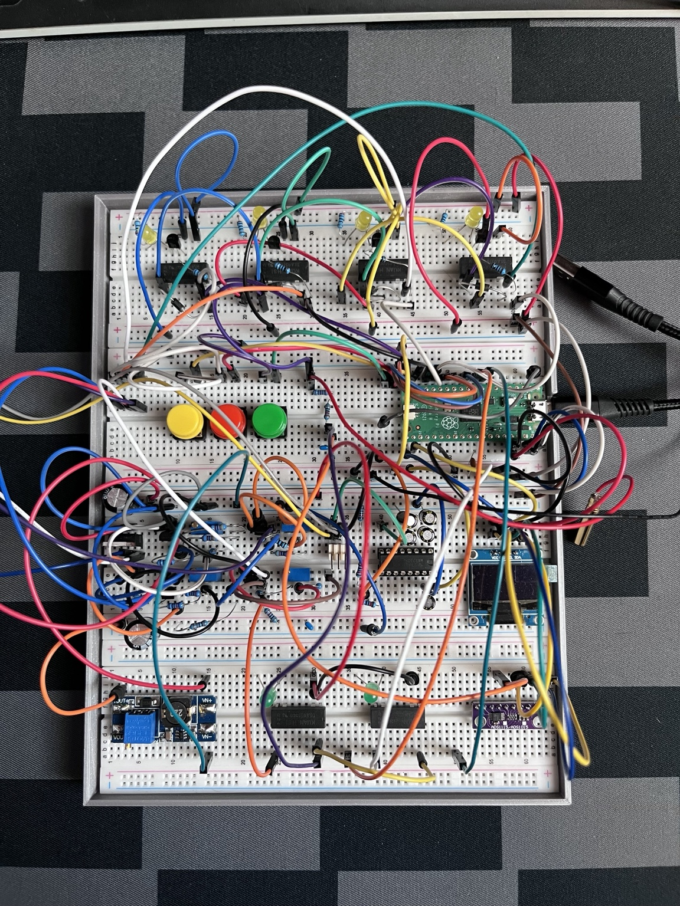
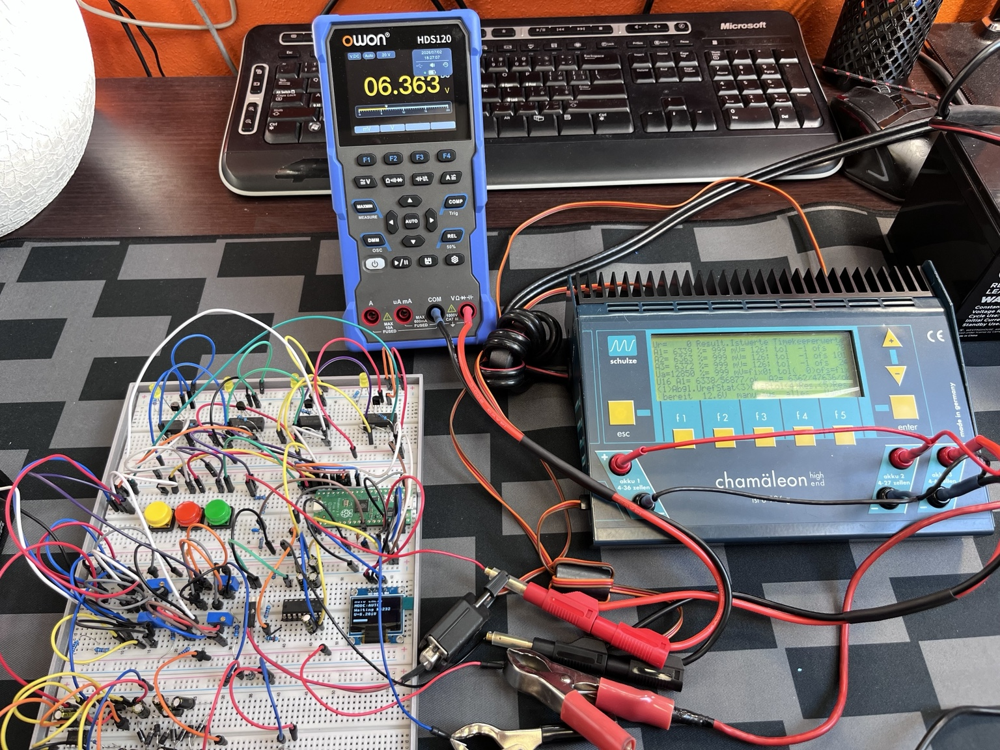

# XCAL for Schulze ISL8-936G

**Raspberry Pi Pico · automatic factory-calibration reference selector · RS-232 protocol analysis**

An independent hardware/software project by **Martin Stránský (Prometheuss80)** for investigating and reproducing the reference-voltage switching sequence used by the original Schulze ISL8-936G factory calibration procedure.

**Project status:** The breadboard prototype and a real ISL8 calibration test are documented in the photographs, and a complete automatic calibration exchange is captured in the included serial log. The Pico firmware is supplied as developed; no new firmware build or bench verification was performed when preparing this public package.

## What XCAL does

XCAL is an external **reference-voltage switching controller**, not a replacement for the charger's factory calibration algorithm. In factory-calibration mode, the ISL8 emits serial `SetUref` commands after the operator starts the procedure using **Bereit**. A Raspberry Pi Pico receives these commands at **9600 baud**, selects one of four external voltage-reference outputs and monitors the selected voltage using an ADS1115 ADC. The **ISL8 itself** measures the four reference points, calculates calibration TOL/OFS coefficients for A1/A2/A3, and repeats the voltage measurements to verify the correction.

| `SetUref` value | Selected external reference | Pico state | Select output |
|---|---:|---|---|
| `10` | **3.000 V** | `STAV_UREF_3V` | GPIO 15 |
| `8` | **4.200 V** | `STAV_UREF_4V` | GPIO 14 |
| `4` | **8.400 V** | `STAV_UREF_8V` | GPIO 13 |
| `0` | **12.600 V** | `STAV_UREF_12V` | GPIO 12 |

**Important:** These voltages are generated by an **external precision reference and switching circuit**, not directly by the Pico GPIO. GPIO values merely select the relevant hardware path. Confirm the actual outputs with a calibrated meter before connecting a charger. Do not apply these voltages to the Pico GPIO or ADC inputs directly.

## Components

- Raspberry Pi Pico running MicroPython (the supplied `main.py` targets Pico GPIO layout; Pico 2 requires separate hardware validation).
- Four-position external precision-voltage and switching circuit.
- ADS1115 ADC (`0x48`) for checking the selected voltage through a resistor divider.
- I²C SSD1306 display, **128 × 64** pixels, with compatible MicroPython driver.
- UART/RS-232 electrical interface compatible with the Schulze port. **Use the correct level translator; Pico UART pins are 3.3 V logic, not RS-232 voltage levels.**
- External output drivers / relay protection as required by the circuit; Pico GPIOs must not directly drive relay coils beyond their ratings.

Pin assignments and operating modes: [Hardware and setup](docs/HARDWARE.md).

## Firmware files

- [`firmware/main.py`](firmware/main.py) — automatic/manual mode, UART receiver, voltage selection, ADC calibration and OLED interface.
- [`firmware/ads1115.py`](firmware/ads1115.py) — ADS1115 driver used by the project.
- [`firmware/test_ads1115.py`](firmware/test_ads1115.py) and [`firmware/test_i2c.py`](firmware/test_i2c.py) — diagnostic scripts.
- [`assets/xcal.pbm`](assets/xcal.pbm) — XCAL splash bitmap.

`main.py` additionally imports the **MicroPython SSD1306 driver** (`ssd1306.py`), which is not included in this release pending confirmation of third-party licensing and origin. Copy a compatible SSD1306 driver onto your Pico. Its optional `schulze.pbm` startup logo is also not redistributed; missing this file causes the program to show its built-in `LOGO ERROR` screen briefly, then proceed.

The MicroPython UF2 images, Pico pinout artwork and historic TL431 Excel workbook found in the research archive are **not redistributed** here because they were not developed as part of this project. Obtain firmware and drivers from their original maintainers; consult [`THIRD_PARTY.md`](THIRD_PARTY.md).

## Typical use

1. Verify reference voltages 3.000, 4.200, 8.400 and 12.600 V with a calibrated instrument, plus a safe idle/disconnected state.
2. Verify the isolated/suitable RS-232 electrical interface between Pico and charger.
3. Install a suitable MicroPython build and SSD1306 driver, then copy the project `.py` files and `assets/xcal.pbm` as `xcal.pbm` to the Pico root. If available and properly licensed, copy your local `schulze.pbm` there too.
4. Power the controller, let it calibrate its ADC reading, and confirm normal OLED operation.
5. Start the original ISL8 factory calibration procedure; select **Bereit** as described in the original service workflow.
6. Monitor serial commands and external reference outputs. Do not interrupt EEPROM/Timekeeper calibration-data writes.
7. Confirm the charger's final verification step and save a backup of the calibration values.

See [calibration sequence](docs/CALIBRATION_FLOW.md) and [an annotated serial log](docs/LOG_ANALYSIS.md).

## Hardware demonstration

### XCAL breadboard prototype

*XCAL hardware prototype assembled on a breadboard. The Pico controls the external voltage-reference selection circuitry.*

### Calibration bench test

*Real bench setup with XCAL, an ISL8 charger and an independent measuring instrument. The meter reading shown is a momentary test observation, not a declared calibration reference value.*

Additional photograph details: [photo gallery](docs/PHOTOS.md). A representative serial log of the factory calibration sequence (device number redacted) is included: [`logs/CALIB_LOG_REDACTED.log`](logs/CALIB_LOG_REDACTED.log).

## Scope and limitations

The code currently chooses outputs using `SetUref` and recognizes the German completion message containing `fertig`. It supports manual selection by buttons; it is not a general-purpose voltage standard. The implementation calibrates the ADC using a hard-coded **4.205 V** reference assumption and a divider defined as **20 kΩ / 2.2 kΩ**; these are design-specific values to validate against your assembled hardware. The firmware does not itself prove reference accuracy, output settling time or electrical isolation.

**Safety:** Incorrect references may corrupt calibration and cause unsafe voltage measurement. Use professional measurement equipment, back up calibration and stored settings, and test without a connected battery until the assembly is validated.

## Author and license

**Martin Stránský (Prometheuss80)** · Copyright © 2026.

Original XCAL software and documentation in this release are provided under the [MIT License](LICENSE). Original Schulze firmware, names/logos, MicroPython firmware and other third-party materials are not covered by this grant. This is an independent project, not affiliated with or endorsed by Schulze Elektronik GmbH.
