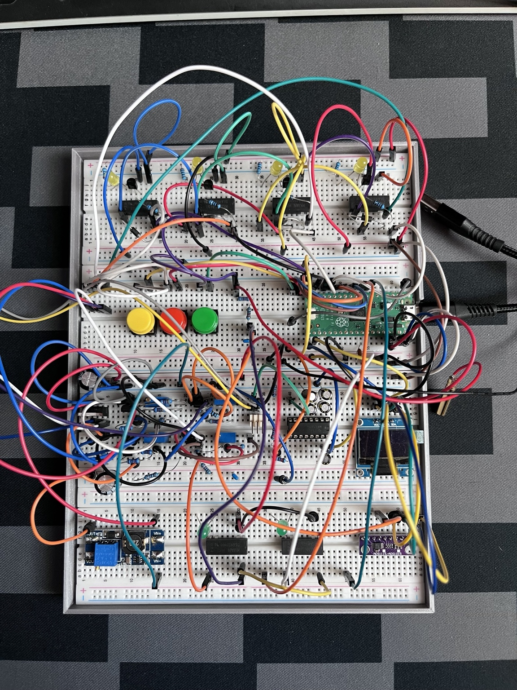
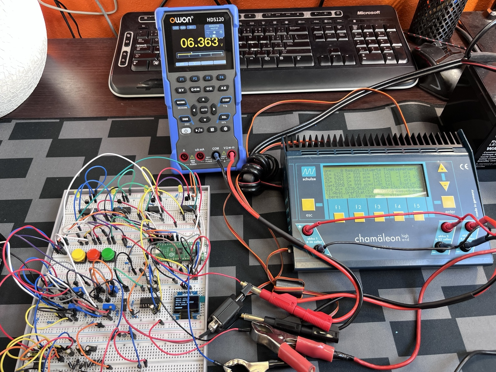

# XCAL pro Schulze ISL8-936G

**Raspberry Pi Pico · automatické přepínání referenčních napětí · výzkum tovární kalibrace**

Autor: **Martin Stránský (Prometheuss80)**. Nezávislý servisní a výzkumný projekt pro tovární kalibraci ISL8.

XCAL **nepočítá kalibrační konstanty za nabíječ**. Originální tovární kalibrace Schulze přes RS-232 posílá `SetUref`, externí obvod přepne přesnou referenci a nabíječ změří napětí, vypočte TOL/OFS pro A1/A2/A3 a zopakuje kontrolní měření.

| RS-232 příkaz | Referenční napětí | Výběrový pin Pico |
|---|---:|---|
| `SetUref:10` | 3,000 V | GPIO15 |
| `SetUref:8` | 4,200 V | GPIO14 |
| `SetUref:4` | 8,400 V | GPIO13 |
| `SetUref:0` | 12,600 V | GPIO12 |

Reálná napětí poskytuje **externí přesný referenční obvod**, nikoli GPIO Pico. Připojení RS-232 musí zahrnovat odpovídající převod úrovní; Pico používá logiku 3,3 V.

Firmware používá MicroPython, SSD1306 OLED 128×64, ADS1115 a sériový port 9600 baud. Lze volit režim AUTO (příkazy ISL8) nebo MANUAL (tlačítka PLUS/MINUS). RESET přepne zpět do AUTO.

Dokumentace: [zapojení](docs/HARDWARE.md), [průběh kalibrace](docs/CALIBRATION_FLOW.md), [výklad logu](docs/LOG_ANALYSIS.md).

V přiloženém logu kalibrace končí řádkem `(CHK=  0) fertig`. V archivu jsou také původní pracovní soubory jiných autorů (UF2, tabulka TL431 a pinout), které do veřejného vydání zatím nepřebíráme. Kompatibilní ovladač `ssd1306.py` je potřeba doplnit zvlášť; volitelné `schulze.pbm` logo není součástí vydání.

## Fotografie funkčního prototypu

*Prototyp XCAL na nepájivém poli s Raspberry Pi Pico a externími obvody pro výběr referenčních napětí.*

*Kalibrační pracoviště s XCAL, nabíječem ISL8 a nezávislým měřicím přístrojem. Údaj na měřidle zachycuje okamžik testu, nikoli deklarovanou hodnotu reference.*

Další podrobnosti: [fotogalerie](docs/PHOTOS.md).

**Upozornění:** Před použitím ověř referenční napětí kalibrovaným voltmetrem. Chybná kalibrace může mít bezpečnostní následky. Uchovej zálohu kalibračních dat.

© 2026 Martin Stránský (Prometheuss80). Vlastní zdrojový kód a dokumentace: [MIT](LICENSE). Originální firmware Schulze a soubory třetích stran nejsou součástí této licence.
