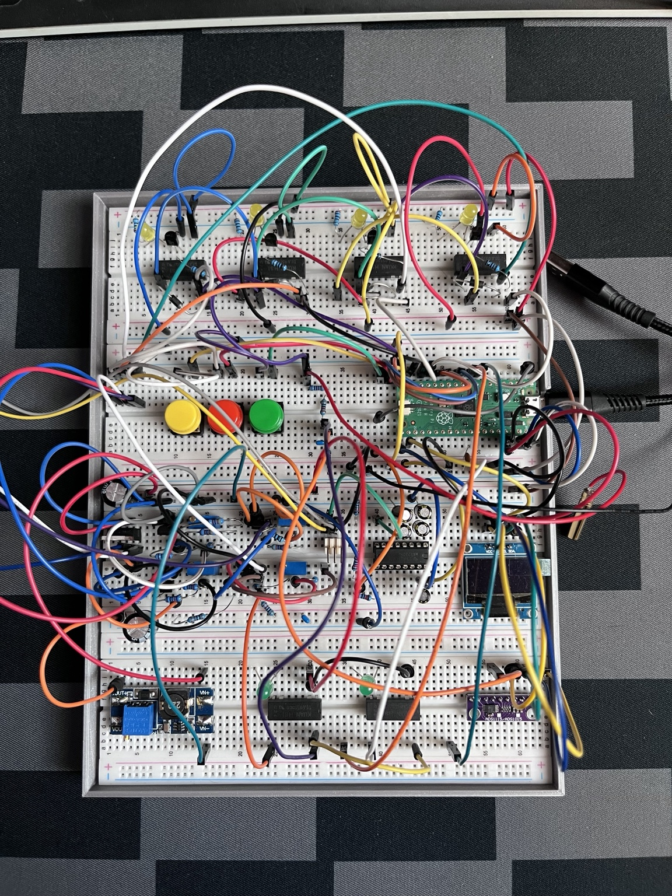
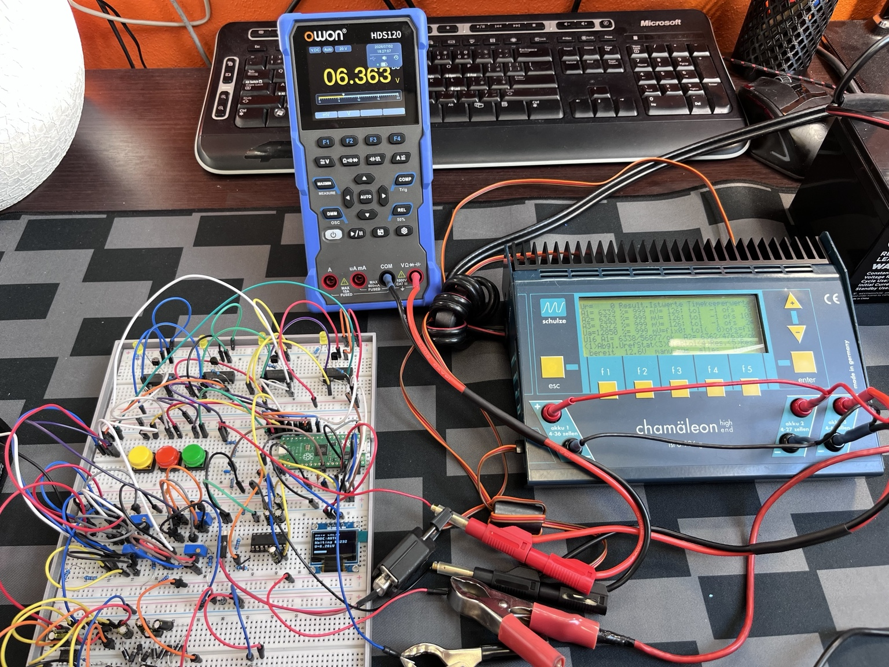

# XCAL for ISL8 — hardware photographs

The two photographs show the actual XCAL project prototype and the calibration test bench.

## 1. Breadboard prototype

**File:** `docs/images/xcal_for_isl8.jpg`  
**Original photograph:** `IMG_4691.jpeg`  
**Description:** XCAL breadboard prototype, Raspberry Pi Pico, reference-selection components and manual controls.

## 2. ISL8 calibration bench test

**File:** `docs/images/xcal_for_isl8_calibration_test.jpg`  
**Original photograph:** `IMG_4558.jpeg`  
**Description:** XCAL prototype connected to the ISL8 charger, with an external measuring instrument and charger display during testing. The meter value visible in the photo is an instantaneous measurement, not a specification for any of the four reference outputs.

The JPEG file content is unchanged from the supplied photographs; only the public file names were made descriptive.
