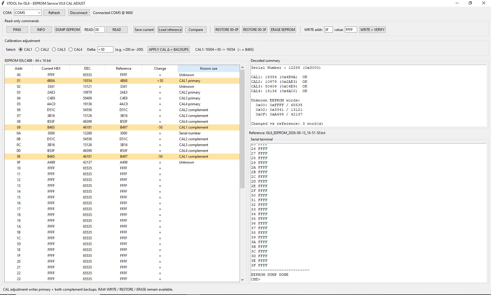
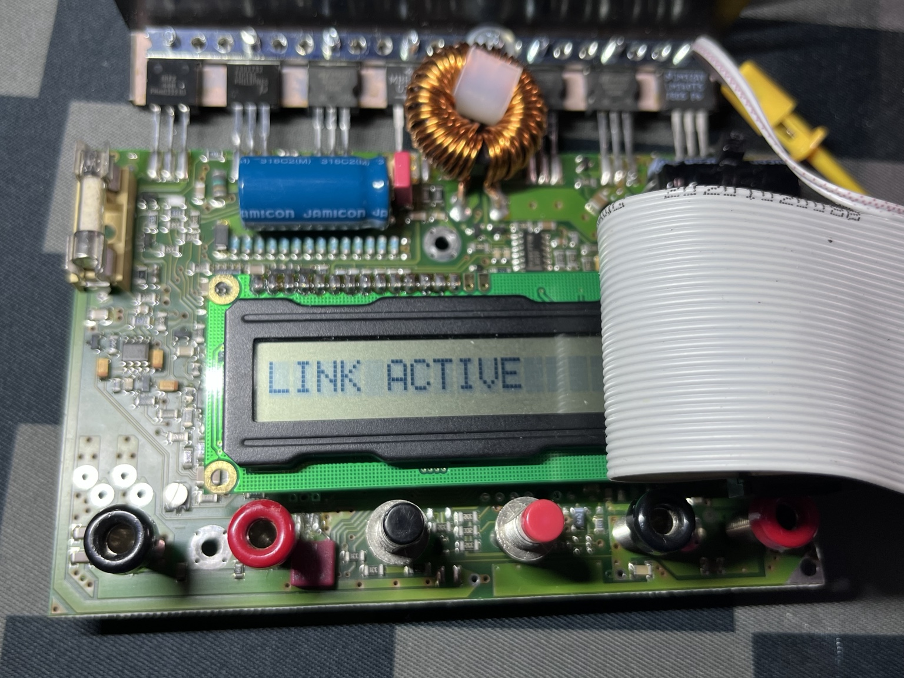
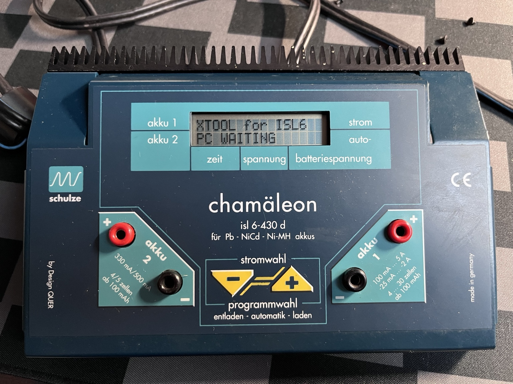
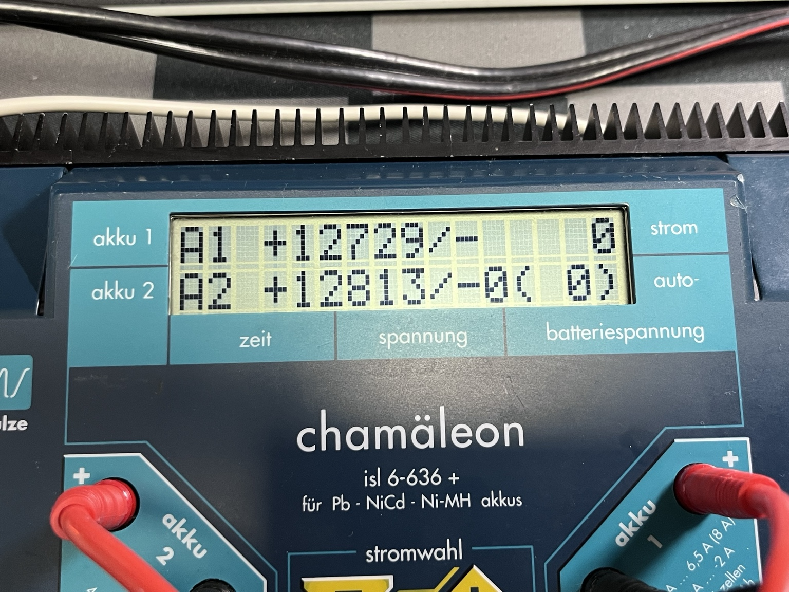
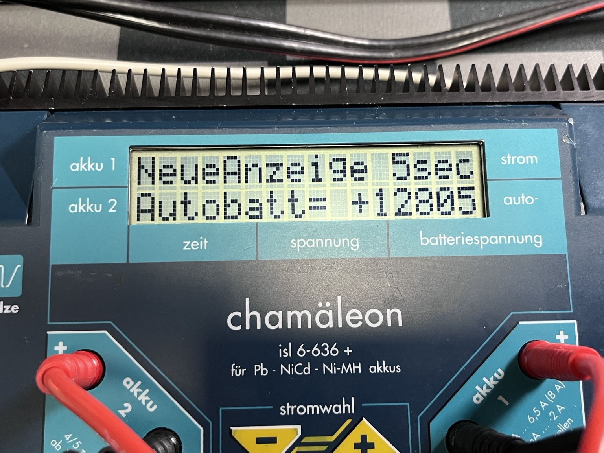

# XTOOLS for Schulze ISL6

**Standalone service firmware and PC GUI for EEPROM calibration, backup, and recovery.**

**Author:** Martin Stránský (**Prometheuss80**)  
**Firmware:** XTOOLS ISL6 **V0.8 UNIVERSAL** (as identified by its source code)  
**PC GUI:** **V0.9 UNIVERSAL** (as identified by its Python source)  
**License:** MIT (original code and documentation in this project; not any third-party material)

Independent community reverse-engineering and preservation project, not affiliated with Schulze Elektronik GmbH.

## Overview

XTOOLS consists of two cooperating programs:

1. **ISL6 service firmware** runs on the charger’s Siemens 80C535 MCU. It selects the hardware profile, reads the 93C46/93LC46 EEPROM, shows information on the LCD, and provides a serial command interface.
2. **PC GUI** (`xtools_isl6_gui.py`) connects to XTOOLS over serial to display calibration and serial-number information, read and save a 64-word EEPROM dump, compare it with a reference, and write/verify selected words. The GUI also supports calibration adjustments with both complementary backup words, restoring saved dumps, and an explicit full-EEPROM erase operation.

**Back up the entire EEPROM before attempting any write.** Inappropriate values can affect calibration, identity, and charger behavior.

## Supported hardware profiles

| Profile | Charger family | LCD | EEPROM interface |
| --- | --- | --- | --- |
| MODE 1 | ISL6-330D | 1×16 character | 4-wire: P5.7 CS, P5.6 CLK, P5.5 DI, P5.4 DO |
| MODE 2 | ISL6-430 / 530 / 636 family | 2×16 character | 3-wire: P5.4 CS, P5.5 CLK, P5.6 common DI/DO |

The hardware mode is selected **before any EEPROM access**. At startup the charger displays **PRESS LEFT KEY**. Press the *physical left key*: due to the reversed key wiring between families, it selects P1.7 / MODE 1 on the 330D or P1.6 / MODE 2 on the 430/530/636 family. Verify your own hardware revision before writing.

## Files

```text
ISL6-XTOOLS/
├── README.md
├── README_CS.md
├── LICENSE
├── firmware/
│   ├── hex/xtools_isl6.hex
│   └── source/                   # original Keil C and A51 files
├── gui/xtools_isl6_gui.py
└── docs/
    ├── HARDWARE.md
    ├── EEPROM.md
    ├── SERIAL_PROTOCOL.md
    └── VERIFICATION.md
```

The original supplied source filenames and contents are retained unchanged.

## Hardware photos and PC GUI

The following photos document the running service firmware and its PC interface on real Schulze hardware. They show examples of the ISL6 family; hardware configuration and display messages may vary by model.

### EEPROM service GUI



*PC GUI connected over serial, showing EEPROM data, four calibration values, complementary backup values, and the decoded serial number. The screenshot contains sample device data, not universal calibration settings.*

### XTOOLS running on the charger

| ISL6-330 hardware / serial link | ISL6-430 charger / PC waiting |
| --- | --- |
|  |  |

| ISL6-636 calibration display | ISL6-636 service information display |
| --- | --- |
|  |  |

For additional photos of the serial interface board and descriptions, see the [photo gallery](docs/PHOTOS.md).

## Running the PC GUI

Requires Python 3, Tkinter (normally bundled with desktop Python installations), and `pyserial`:

```bash
python -m pip install pyserial
python gui/xtools_isl6_gui.py
```

Connect your PC via the appropriate serial interface, select the COM port and click **Connect**. The GUI uses **9600 baud, 8N1** and sends `PING` and `INFO` after connecting. Use **DUMP EEPROM** to fetch current values; save a complete dump before any modifications.

The charger firmware initially opens a **30-second service-command window**. Each valid command resets that window. When it expires, the charger switches to the LCD overview. The GUI sends `RESET` when disconnecting; the firmware then deliberately triggers a watchdog restart.

## Features

- Read individual EEPROM words (`READ`) and entire 64 × 16-bit EEPROM (`DUMP`)
- Decode four calibration values and display `OK` or `FAULT` for the complementary backup words
- Display serial number (EEPROM word `0A`)
- Save text dumps, load reference dumps, compare values
- Write and verify individual EEPROM words
- Adjust CAL1–CAL4 with corresponding redundant inverted copies
- Restore words `00–0F` or the full EEPROM `00–3F` from a complete dump
- Erase all EEPROM words to `FFFF` after double confirmation (**destructive**)

See [EEPROM layout](docs/EEPROM.md), [hardware profiles](docs/HARDWARE.md), and [serial protocol](docs/SERIAL_PROTOCOL.md).

## Safety and scope

Service firmware **replaces normal charger operation** while installed. Do not attempt to charge or discharge batteries under service firmware. EEPROM writing, restore and erase are potentially destructive; confirm that a backup is complete and belongs to the same physical charger before writing it back. Avoid publishing dumps containing a device serial number.

Only firmware and GUI supplied in this archive are included; no original Schulze firmware is bundled. This release describes the supplied code and HEX; it does not certify all hardware revisions. See [verification details](docs/VERIFICATION.md).

## License and credits

Copyright © 2026 **Martin Stránský (Prometheuss80)**. Own code and documentation: [MIT](LICENSE). Schulze trademarks and original third-party works are not licensed by this project.
