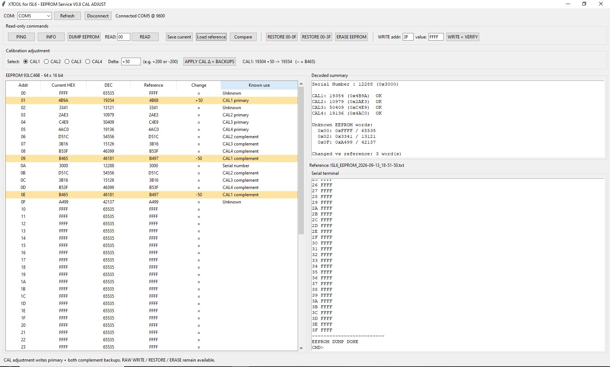
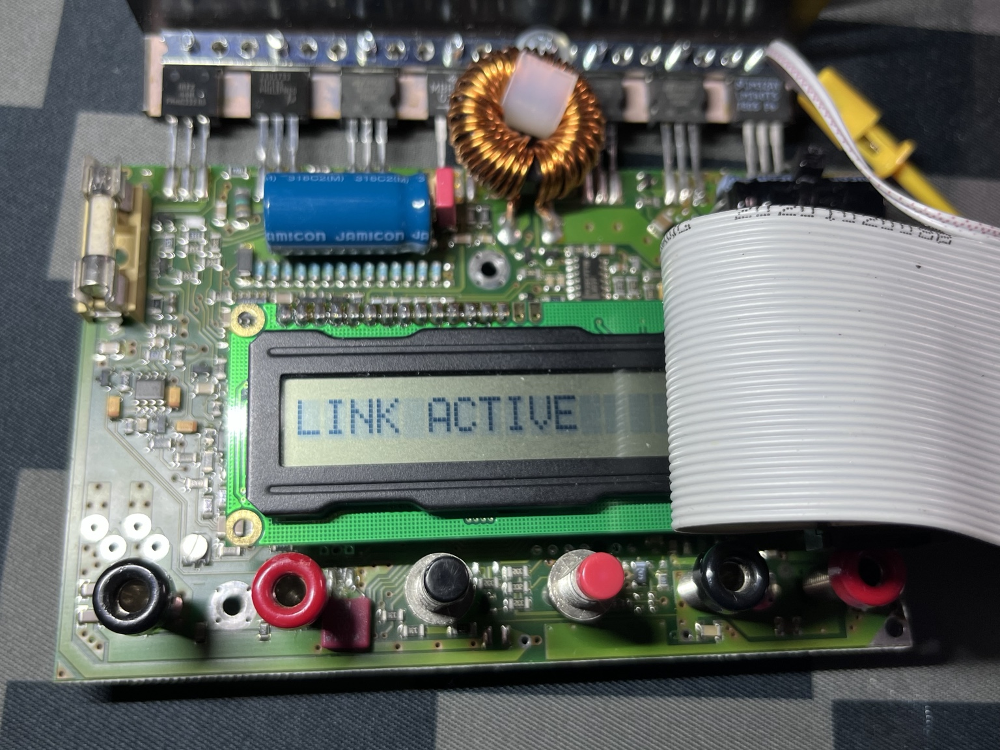
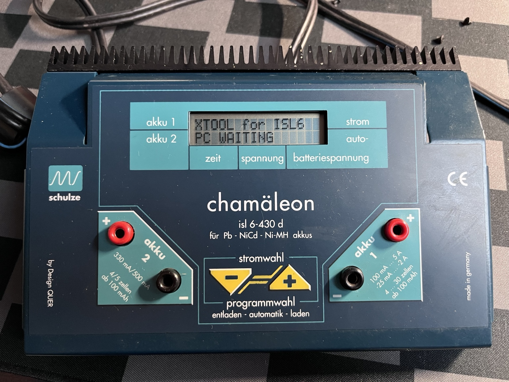

# XTOOLS pro Schulze ISL6

**Autor:** Martin Stránský (Prometheuss80)  
**Firmware:** V0.8 UNIVERSAL · **PC GUI:** V0.9 UNIVERSAL  
**Licence vlastní tvorby:** MIT

XTOOLS tvoří **servisní firmware spuštěný přímo v nabíječi** a **Python GUI pro PC**. Firmware umožňuje přístup k EEPROM 93C46/93LC46 (64 × 16 bitů) a přenos dat přes sériové rozhraní. GUI zobrazuje kalibrace CAL1–CAL4, jejich kontrolní kopie a sériové číslo; umí uložit výpis, porovnat jej se zálohou a zapsat nebo obnovit hodnoty včetně kontroly přečtením.

## Volba hardwarové řady

Po spuštění se zobrazí `PRESS LEFT KEY`. Stiskni **fyzické levé tlačítko**. V obou řadách vybere správný profil, i když je jejich elektrické zapojení tlačítek opačné.

- **ISL6-330D:** LCD 1×16; EEPROM čtyřvodičová (P5.7 CS / P5.6 CLK / P5.5 DI / P5.4 DO).
- **ISL6-430/530/636:** LCD 2×16; EEPROM třívodičová (P5.4 CS / P5.5 CLK / P5.6 společná DI/DO).

## Fotografie funkčního projektu



*PC aplikace při komunikaci s nabíječem. Zobrazené hodnoty patří konkrétnímu zařízení a nejsou univerzální kalibrací.*

| XTOOLS – LINK ACTIVE | XTOOLS – PC WAITING |
| --- | --- |
|  |  |

Další fotografie jsou v [galerii](docs/PHOTOS.md).

## Spuštění GUI

```bash
python -m pip install pyserial
python gui/xtools_isl6_gui.py
```

Vyber COM port, připoj se rychlostí **9600 8N1** a spusť `DUMP EEPROM`. **Nejdříve vždy ulož kompletní zálohu EEPROM.** Firmware otevírá 30sekundové okno pro sériové příkazy; každý platný příkaz jeho čas obnovuje.

GUI umožňuje také `WRITE`, změny kalibrace včetně dvou invertovaných záloh, `RESTORE` a úplné smazání EEPROM zápisem `FFFF` do všech 64 slov. **Poslední funkce je nevratná bez spolehlivé zálohy!** Obnova z jiné nabíječky může změnit sériové číslo i kalibraci.

Podrobnosti jsou v anglických dokumentech `docs/` a v hlavním [README](README.md). Původní zdrojové soubory a HEX z dodaného balíčku zůstaly beze změny.
