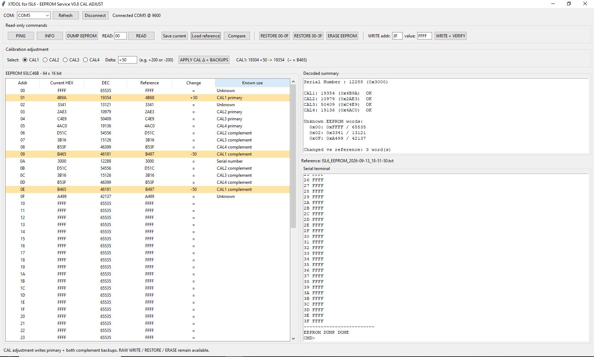
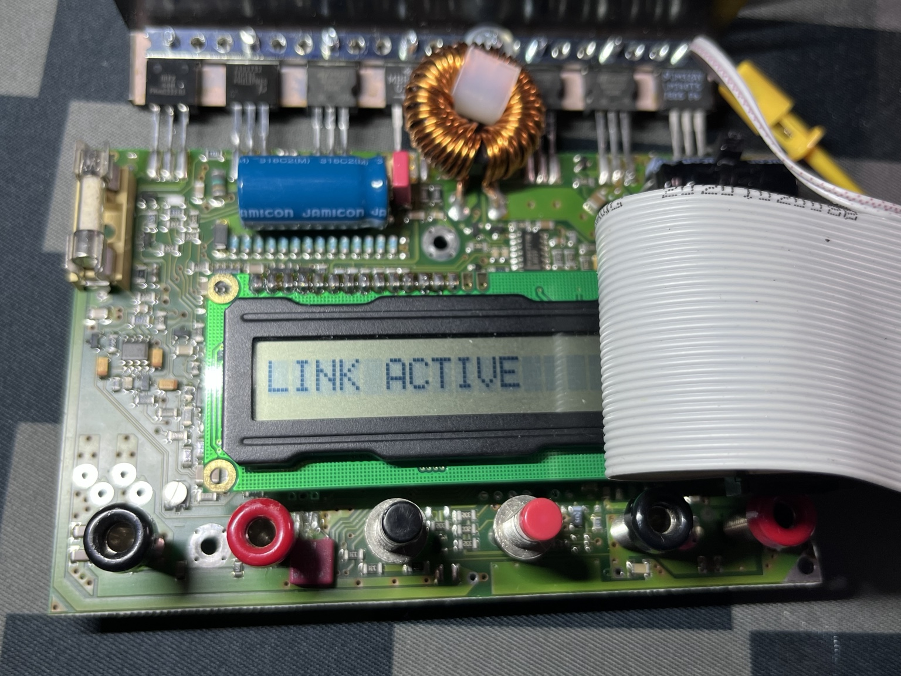
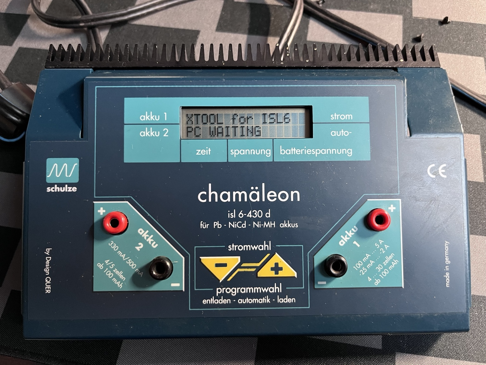
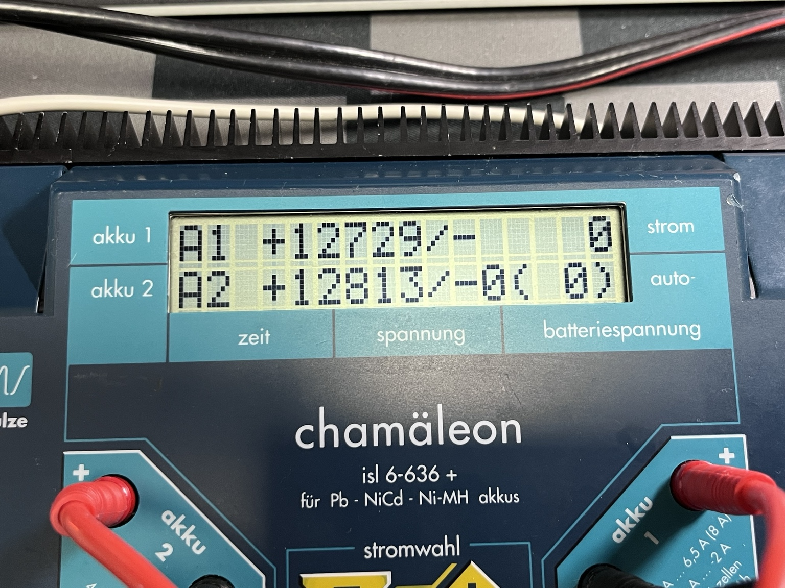
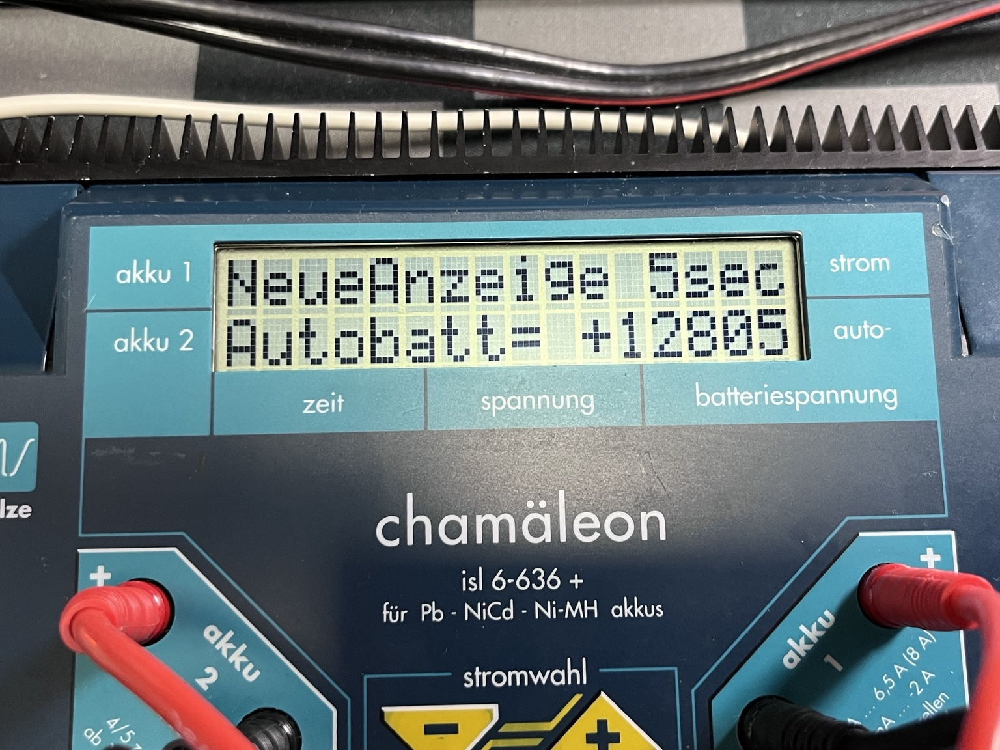
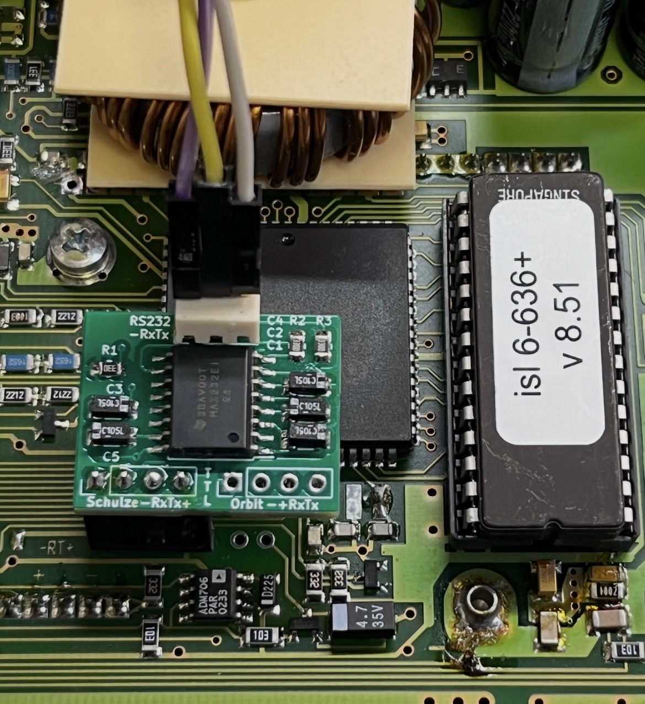

# XTOOLS ISL6 – Hardware and GUI photo gallery

Photos supplied by **Martin Stránský (Prometheuss80)** and documenting real hardware and the running XTOOLS software.

## EEPROM service and calibration GUI

The GUI displays EEPROM addresses, HEX and decimal values, a comparison with a saved reference, the decoded serial number, and calibration values with complementary backup words. Values visible in the screenshot are device-specific examples.

## Serial link active (ISL6 hardware)

The service firmware is running on an open charger PCB. The LCD confirms an active serial link. A ribbon cable partly covers the display.

## PC waiting (ISL6-430D)

The charger awaits the PC GUI connection while running service firmware.

## Calibration display on ISL6-636+

Two rows of calibration information are visible on the charger's LCD.

## ISL6-636+ service information

An additional service information screen on the two-row LCD.

## Serial interface and ROM hardware

Close-up showing the serial adapter board and the socketed ROM on the ISL6 mainboard.

---

All photos document physical test setups. No claim is made that the pictured device-specific values should be copied to other chargers. Firmware and GUI source files are unchanged from the original release package.
